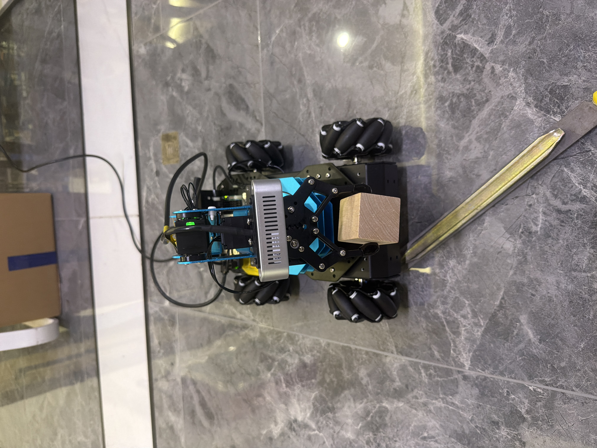

# JCHENG Manipulation

**Measured visual manipulation on a 5-DoF ArmPi Ultra: corrected model, self-implemented calibration, real grasp execution and a quantitative reliability budget.**

**English** | [简体中文](README.zh-CN.md)

> A project-based master's capstone in applied robotics. The repository is the
> complete, evidence-backed record of the work: a corrected 5-DoF model and TF
> tree, constrained MoveIt 2 planning, a self-implemented hand–eye calibration
> validated against independent markers, real pick–lift–place execution, a
> safety veto, and a measured failure taxonomy. Vendor firmware and drivers are
> treated as a **read-only baseline** and are never copied into this repository.

> Historical note: the repository began as an 8-week ROS 2/Panda learning
> project. That record is archived at
> [`docs/archive/README_8WEEK.md`](docs/archive/README_8WEEK.md) and
> [`docs/weekly-log/`](docs/weekly-log/); it is not part of the capstone
> claims. Earlier Panda and M2.2 artifacts are retained for traceability.

**Contents:** [At a glance](#at-a-glance) · [Abstract](#abstract) ·
[Objectives](#objectives-and-contributions) ·
[Key results](#key-results-measured-on-hardware) ·
[Architecture](#system-architecture) · [Repository layout](#repository-layout) ·
[Status](#project-status-2026-11-21) ·
[Deliverables](#capstone-deliverables-checklist) · [Quick start](#quick-start) ·
[Method](#experimental-method) · [Failure taxonomy](#failure-taxonomy-measured) ·
[Safety](#safety-and-operating-envelope) ·
[Limitations](#limitations-and-threats-to-validity) ·
[Evidence](#reproducibility-and-evidence-map) · [Documentation](#documentation) ·
[Conclusion](#conclusion) · [Roadmap](#roadmap) · [License](#license)

<p align="center">
  
  <br>
  <em>First real grasp (2026-11-18): the arm holds a 39.4 mm wooden cube on the floor.
  The fully autonomous pick–lift–place sequence followed on 2026-11-19.</em>
</p>

## At a glance

| Item | Summary |
|---|---|
| **Platform** | HiWonder ArmPi Ultra: 5-DoF arm, two-finger gripper, mecanum chassis, Raspberry Pi 5, wrist Aurora 930 RGB-D camera and chassis-front RealSense D435i |
| **Software** | ROS 2 Humble on the robot, ROS 2 Jazzy on the workstation, MoveIt 2 + Pilz `PTP` + KDL, FastAPI/React debug studio |
| **Core question** | How accurately can a low-cost 5-DoF arm with a wrist-mounted camera manipulate tabletop objects when every transform, limit and failure mode is measured rather than assumed? |
| **Headline result** | Autonomous pick–lift–place of an unmarked 39.4 mm cube; the pre-registered **24-pair** trial raised grasp success from **12/24 to 24/24** (McNemar p = 0.00049); the completed error budget has translation **RSS 13.33 mm** (bounds fail 6 mm) while the empirical placement mean is **3.08 mm**; S-curve motion cuts grasp+put-back from **11.67 s to 8.94 s**; a chassis D435i agrees with the wrist camera to **2.58 mm** in x/y |
| **Evidence** | 20+ evidence bundles: session logs, calibration datasets, servo/bus records, Studio test reports and machine-readable JSON |
| **Status** | 2026-11-21. Hardware motion is supervised; joint mapping is `verified: true` for the operating envelope after the formal survey; the robot has no e-stop or brake |

## Abstract

This project asks whether a low-cost 5-DoF arm with a wrist-mounted RGB-D
camera can perform repeatable tabletop visual grasping when every transform,
limit and failure mode is measured rather than assumed. The ArmPi Ultra is
modelled as a constrained 5-DoF manipulator, and the camera is calibrated to
`link4` with a self-implemented chessboard hand–eye procedure (14 poses,
2.94 mm / 0.39° board-pose scatter, 3.29 mm / 0.43° held-out). A markerless
RGB-D segmentation, joint-space grasp search, MoveIt/Pilz `PTP` execution and
an independent trajectory veto form the grasp pipeline. Five real
pick–lift–place attempts were run on an unmarked 39.4 mm cube; three
succeeded. Passes 3–4 failed and exposed a systematic −8.0/−15.3/−5.8 mm
FK/hand–eye error at the low grasp configuration; a single AprilTag
observation at that configuration supplied a correction, after which pass 5
held the cube, lifted it ≈148 mm and released it. A fixed-tag survey then
showed the low-configuration error is a **constant** vector, joint-offset and
`link4`-frame models were fitted and **rejected**, and at a 27.9° yaw the
constant remained the closest model (5.6 mm away, 3.3 mm on the grip-critical
axis) while the fitted models were 14–19 mm away. A **pre-registered 24-pair
hardware trial** raised grasp success
from 12/24 to 24/24 (McNemar p = 0.00049) with a 2.19 mm paired placement
improvement. All five arm joints were formally surveyed by hand (the stops are
pose-dependent self-collision limits), repeatability and backlash were
measured (0.449 mm RMS, 1.117 mm), and a 46-grasp grid measured the grip
tolerance at ±9 mm. A 2026-11-20 session then measured the three remaining
error-budget sources — grasp execution **5.39 mm / 1.50° max**, gripper
placement **11.51 mm max / 3.08 mm mean** and object-fixture pose **14.82 mm
radial max** — completing the budget. The component bound budget fails the
6 mm gate (translation RSS **13.33 mm**), while the empirical corrected
placement mean (**3.08 mm**) is inside it. The project contributes a measured
failure taxonomy, a physical reliability experiment and an explicit evidence
trail; the 2° rotation tolerance is still provisional because no direct
rotation-tolerance experiment exists. The same day added a chassis-front
RealSense D435i as an independent `base_link` observer (2.58 mm x/y agreement
with the wrist camera), S-curve motion that cut the grasp+put-back cycle from
11.67 s to 8.94 s, and two later runs that added an in-view grasp (4.77 s /
4.44 s, 0.92 mm landing) and a far-cube run at 0.464 m which reversed the base
home while holding the cube (11.06 mm placement error against the fitted
target; the return itself remains open-loop). A random-placement 24-pair
follow-up was pre-registered on 2026-11-21: the operator places the cube at a
fresh haphazard point in the sensor-covered region before every pair; the
fixed 24-mark fan was superseded before data and never run.

## Objectives and contributions

**Objectives**

1. Reconstruct a trustworthy 5-DoF model: joint types, limits, TF and camera
   frames verified against the live robot.
2. Build a self-implemented calibration workflow with independent validation,
   instead of relying on vendor defaults.
3. Execute real visual grasps under constrained planning and an independent
   safety veto.
4. Quantify the error sources and identify the dominant term.
5. Make the system observable and reproducible: every claim has a command,
   log or data file behind it.

**Contributions**

1. **Measured model and frame contract.** A corrected xacro model, live TF
   verification, and a measured body→optical adapter (`camera_optical_calibrated`)
   used by the fiducial localizer.
2. **Self-implemented calibration with independent checks.** Chessboard
   hand–eye, table-down re-calibration, and a physical AprilTag scale test that
   exposed a 4.87 % table-forward bias.
3. **A complete real grasp pipeline.** RGB-D segmentation → constrained
   grasp search → Pilz `PTP` plan → safety veto → measured servo execution →
   verification, exercised end-to-end on hardware, now with a jerk-limited
   S-curve path and a chassis-camera veto/verifier.
4. **A measured low-configuration error and a tested model.** A fixed-tag
   survey showed the FK/hand–eye error at the low grasp configuration is a
   **constant (+11.6, +4.0, +8.5) mm** vector (spread 0.40–0.99 mm), with the
   grasp-validated correction **(+13.7, +3.9, +8.9) mm**, while the same model
   is 2–3 mm in its validated volume. Joint offsets and `link4`-frame models
   were fitted and **rejected**: they predict the correction 10.6–15.0 mm
   away from what four passing grasps used.
5. **A pre-registered paired hardware trial.** 24 matched pairs compared the
   raw FK/hand–eye target with the constant low-configuration correction:
   **12/24 vs 24/24** success (McNemar p = 0.00049) and a **2.19 mm** paired
   placement improvement among dual-success pairs (95 % CI −3.96…−0.83 mm,
   p = 0.0063), with four protocol deviations recorded and quantified.
6. **A completed measured error budget.** Repeatability **0.449 mm RMS /
   1.017 mm max** over 30 visits, backlash **1.117 mm**, grasp execution
   **5.386 mm / 1.495° max** over 20 grasps, gripper placement **11.514 mm max
   / 3.080 mm mean** over 20 put-backs and fixture **14.815 mm radial max**
   over 20 placements. The complete bound budget is **13.325 mm RSS /
   24.014 mm worst case** (translation) and **1.858° / 3.322°** (rotation),
   dominated by placement (74.7 %) and execution rotation (64.7 %); the
   empirical corrected placement mean (3.080 mm) is inside the 6 mm tolerance,
   and the 2° rotation gate remains provisional.
7. **A safe joint-limit survey.** EEPROM-bounded adopted limits, a powered
   probe to the mechanical stops, and tooling that avoids the vendor node's
   negative-register crash.
8. **Reliability tooling.** Error-budget framework, paired-trial recorder and
   runner, measurement runner, read-only host/DDS benchmark, and a G1–G6 debug
   studio with 93 backend + 47 gateway tests.
9. **Evidence-first documentation.** Every quantitative statement links to a
   timestamped evidence bundle; mock, simulation and hardware results are kept
   separate.
10. **An independently calibrated front camera.** A chassis-front RealSense
    D435i with refined intrinsics (fx = fy 903.5 px, RMS 0.371 px), a measured
    chassis extrinsic (`[0.136, 0.027, 0.038] m`, 31.6° pitch), a depth service
    that survives reboot, a MoveIt collision box, and a Studio aux feed. It
    agreed with the wrist camera to **2.58 mm** in x/y and showed that the
    constant correction is an execution correction, not a measurement bias.
11. **Faster, smoother, measured motion.** A jerk-limited joint-space S-curve
    with bus-servo settle detection replaced single-point 6–9 s moves: the
    grasp+put-back cycle fell **11.67 s → 8.94 s** (−23 %), the no-cube cycle
    from ~37 s to 5.43 s, and the aligned duty-20 base run put the cube back
    **2.22 mm** from its start. Two later runs kept the 4.0/20 envelope: an
    in-view grasp (4.77 s / 4.44 s, **0.92 mm** landing) and a far-cube run
    with a 294.7 + 32.4 mm closed-loop approach, a 2.50 s reverse pulse with
    the cube still held, and an **11.06 mm** landing against the fitted target.

## Key results (measured on hardware)

| Result | Measured value | Evidence |
|---|---|---|
| Hand–eye calibration, 14 poses | **2.94 mm / 0.39°** board scatter; held-out **3.29 mm / 0.43°**; LOO std **3.41 mm / 0.44°** | [`evidence/calibration/20261117/`](evidence/calibration/20261117/) |
| Table-down re-calibration, 15 poses | **2.7 mm / 0.42°** scatter; held-out **2.2 mm / 0.29°**; LOO **3.1 mm / 0.45°** | [`evidence/calibration/20261118/table_down/`](evidence/calibration/20261118/table_down/) |
| Front-camera calibration, D435i | intrinsics **fx = fy 903.5 px**, cx/cy 644.9/363.7, RMS **0.371 px**; chassis extrinsic **[0.136, 0.027, 0.038] m**, pitch **31.6°**, yaw **−1.1°**; board flatness 0.8° | [`evidence/calibration/20261120/`](evidence/calibration/20261120/) |
| Front-camera depth and services | 640×480 Z16, **61.5 % valid**, median 0.312 m; **10.6 Hz** depth-only, 4–9 Hz with colour; `armpi-rs-depth` + `armpi-ext-cam` boot with `NRestarts=0`; IMU unavailable | [`depth_unblock/`](evidence/calibration/20261120/depth_unblock/README.md), [`camera_mount.md`](docs/hardware/camera_mount.md) |
| Fast motion, throughput v2 (two runs) | grasp+put-back motion **11.67 s → 8.94 s (−23 %)**; grasp 4.699–4.729 s, release 4.207–4.259 s; settle 0.14–0.16 s; cube held through both | [`throughput_v2/`](evidence/phase2/onsite_20261120/throughput_v2/) |
| Fast motion, in-view and far return-home (two runs) | in view: grasp **4.77 s**, release **4.44 s**, landing **0.92 mm**; far cube at 0.464 m: grasp **4.76 s**, release **4.31 s**, one 2.50 s reverse pulse with the cube held, landing **11.06 mm** vs the fitted target; both at 4.0/20 | [`fast_motion/`](evidence/phase2/onsite_20261120/fast_motion/) |
| Base duty 20 + auto-base | 1.786 s pulse **178.9 mm (100.2 mm/s)**; 0.484 s strafe **45.3 mm**; aligned cube (0.2316, −0.0025) m, joint1 0.0065, landing **2.22 mm** vs **6.72 mm** yawed | [`throughput_v2/`](evidence/phase2/onsite_20261120/throughput_v2/) |
| Calibration pose selection | **24 poses** from 14,176 evaluated / 3,093 feasible; 33.5° view-angle spread; planned, not executed | [`evidence/calibration/20261117/pose_selection/`](evidence/calibration/20261117/pose_selection/) |
| Independent tag scale | lateral **100.67 mm vs 100.0 mm (0.67 %)**; table-forward **104.87 mm vs 100.0 mm (4.87 %)**; angle **92.3°** | [`evidence/phase2/onsite_20261118/tag_displacement_validation/`](evidence/phase2/onsite_20261118/tag_displacement_validation/) |
| Depth table plane | **147,626 inliers, 0.7 mm RMS**; table z **−0.0787 m** (depth) vs **−0.0784 m** (215 mm ruler) | [`evidence/phase2/onsite_20261118/depth_plane_20261118.md`](evidence/phase2/onsite_20261118/depth_plane_20261118.md) |
| Real grasp trials, first series | **3 / 5** pick–lift–place attempts on the 39.4 mm cube (feasibility, unpaired) | [`grasp_150mm/`](evidence/phase2/onsite_20261119/grasp_150mm/), [`attempt2/`](evidence/phase2/onsite_20261119/grasp_150mm_attempt2/), [`attempt5/`](evidence/phase2/onsite_20261119/grasp_150mm_attempt5/) |
| Best autonomous lift | TCP **+0.0993 m**, object **≈148 mm** above the floor; cube **39.2 × 39.8 mm** | [`attempt5/`](evidence/phase2/onsite_20261119/grasp_150mm_attempt5/) |
| Low-configuration model error | fixed tag: **constant (+11.6, +4.0, +8.5) mm**, per-pose spread **0.40–0.99 mm**; grasp-validated correction **(+13.7, +3.9, +8.9) mm**, release **1.3 mm** | [`low_config_error/`](evidence/calibration/20261119/low_config_error/) |
| Low-config model selection | joint offsets / `link4` 3-DoF / `link4` 6-DoF fit the tag survey (1.4–2.3 mm RMS) but miss the validated correction by **10.6–15.0 mm**; **constant offset supported** | [`model_selection.md`](evidence/calibration/20261119/low_config_error/model_selection.md) |
| Yaw extension of the envelope | at `j1 = 27.9°` the required correction is **(9.14, 7.18, 8.75) mm**; the constant is **5.6 mm** away (grip-critical y **3.3 mm**), the fitted models **14–19 mm** with the y sign flipped | [`yaw_envelope/`](evidence/phase3/onsite_20261119/yaw_envelope/) |
| Paired hardware trial, 24 pairs | **baseline 12/24 vs intervention 24/24** (McNemar **p = 0.00049**); placement error **3.31 mm** vs **4.97 mm**; paired improvement **2.19 mm** (95 % CI −3.96…−0.83, **p = 0.0063**) | [`evidence/phase3/onsite_20261119/`](evidence/phase3/onsite_20261119/README.md) |
| Arm repeatability, 30 visits | radial **0.449 mm RMS / 1.017 mm max**; joints repeat to 0–1 pulse; tag rotation max **0.867°** | [`repeatability/`](evidence/phase3/onsite_20261119/repeatability/) |
| Arm backlash, joint4 ±0.1 rad | hysteresis **1.117 mm** (−0.971, −0.064, −0.549 mm); joint4 settles 10 pulses apart | [`backlash/`](evidence/phase3/onsite_20261119/backlash/) |
| Gripper tolerance envelope, 46 grasps | opening axis passes **[-6, +12] mm** (**±9 mm** about a +3 mm centre = the correction's y residual); `x` and `z` pass at **±9 mm** with no failure; 0/2 at ±15 and −12 | [`envelope/`](evidence/phase3/onsite_20261119/envelope/) |
| Grasp execution, 20 grasps | commanded vs bus-servo at the grasp pose: **4.220 mm / 1.069° mean**, **5.386 mm / 1.495° max** | [`trial_report`](evidence/phase3/onsite_20261120/trial_report.md) |
| Gripper placement, 20 put-backs | landing − pre-grasp: **3.080 mm mean, RMS 4.082 mm, max 11.514 mm**; mean bias **(−0.99, +1.63) mm** | [`trial_report`](evidence/phase3/onsite_20261120/trial_report.md) |
| Object-fixture pose, 20 placements | radial **5.057 mm RMS / 14.815 mm max** on the tape; per-axis SD **5.112 / 0.884 / 0.362 mm** | [`fixture_report`](evidence/phase3/onsite_20261120/fixture_report.md) |
| Completed error budget (2026-11-20) | translation **RSS 13.325 mm / worst 24.014 mm** vs 6 mm; rotation **RSS 1.858° / worst 3.322°** vs the provisional 2°; fixture-inclusive **19.926 mm**; empirical placement mean **3.080 mm** inside 6 mm | [`error_budget.md`](evidence/phase3/onsite_20261120/error_budget.md) |
| Grasp working radius | finger-pad radius **205–210 mm**; `joint1` yaw range **±103.2° (206°)** | [`evidence/phase2/onsite_20261119/reach/`](evidence/phase2/onsite_20261119/reach/) |
| Out-of-view search + base round trip | cube found with a **+16° `joint1` yaw** at **0.469 m**; **0.325 m** closed-loop base approach; grasp + 150 mm lift; return to **9.4 mm** (floor-landmark check); release **1.1 mm** (robot frame) | [`evidence/phase2/onsite_20261119/search_and_return/`](evidence/phase2/onsite_20261119/search_and_return/) |
| Dual-camera grasp, first attempt (2026-11-20) | chassis D435i measured the cube in `base_link` within **2.58 mm** (x/y) of the wrist at the view pose; the validated target `C_view + e` was kept because `e` is a low-config execution correction, not a measurement bias; **grip + put-back** verified by both cameras, **3.65 mm** planar return (front-camera estimate) | [`evidence/phase2/onsite_20261120/dual_grasp/`](evidence/phase2/onsite_20261120/dual_grasp/README.md) |
| Lowest reach | physical lowest point **10 mm**; nominal TCP **15 mm** above the floor; mechanical max at joint2 322 / joint3 939 | [`evidence/phase2/onsite_20261119/lowest_reach/`](evidence/phase2/onsite_20261119/lowest_reach/) |
| Adopted joint limits | servo EEPROM **−20 pulses** (joint2 low from the measured 322 stop → 342), joint2 high tightened to **775** after the formal survey; all five joints hand-measured 2026-11-19; `mapping_verified=true` (operating envelope) | [`docs/phase2/JOINT_LIMITS.md`](docs/phase2/JOINT_LIMITS.md) |
| Gripper stroke | **2.22 rad** (open −2.22, closed 0.0); **~34 counts** backlash; 39.4 mm cube grips at −0.63 | [`evidence/phase2/onsite_20261118/gripper_stops_20261118/`](evidence/phase2/onsite_20261118/gripper_stops_20261118/) |
| Camera / DDS | RGB **~12 Hz** cross-host (in-container undercounts to ~8 Hz); depth **8.2 Hz**; ping **0.24 ms** | [`docs/phase3/HOST_BENCHMARK.md`](docs/phase3/HOST_BENCHMARK.md) |
| Studio G5 stream check | **712 commanded / 711 measured** samples; same-index max **0.008321 rad**, RMSE **0.003962 rad**, dominated by a one-period start offset and pulse quantization | [`evidence/studio_g5/20261118/README.md`](evidence/studio_g5/20261118/README.md) |
| Error budget (2026-11-19, partial: 4/7 translation sources) | translation **RSS 3.995 mm** (pass) / worst **7.114 mm** (fail) vs the measured **6 mm** tolerance; rotation **RSS 1.103° / worst 1.827°** vs the provisional 2° gate (both pass); hand–eye is 68 % of the translation RSS; execution, placement and fixture were still unmeasured | [`error_budget_envelope.md`](evidence/phase3/onsite_20261119/error_budget_envelope.md) |

## System architecture

```text
┌────────────────────────────── workstation (laptop) ──────────────────────────────┐
│  MoveIt 2 (Humble Docker)      armpi_safety veto      armpi_analysis              │
│  Pilz PTP / KDL IK             trajectory checks       error budget, paired tests   │
│  Debug Studio (FastAPI+React)  G1–G6, read-only gateway, G5 recorder               │
└───────────────────────────────────────┬───────────────────────────────────────────┘
                                        │ CycloneDDS over direct Ethernet
                                        │ 10.42.0.1 ↔ 10.42.0.218
┌───────────────────────────────────────┴───────────────────────────────────────────┐
│ Raspberry Pi 5 — vendor Humble core stack + front-camera units                     │
│ ros_robot_controller · servo_manager · camera · TF · start_node.service            │
│ armpi-rs-depth (D435i depth) · armpi-ext-cam (D435i colour + TF)                   │
└───────────────┬───────────────────────────────┬───────────────────────────┬────────┘
                │ 6 bus servos                  │ 4 motor channels          │ USB
        arm joints 2–6 + gripper 1        mecanum chassis (open loop)   Aurora 930 (wrist)
                                                                         D435i (chassis front)
```

The grasp pipeline is:

```text
RGB-D frame
  → floor/table plane fit
  → object mask + voxel cluster + top-slab pose
  → TF to base_link
  → constrained grasp search (position + pitch + wrist roll + approach offset)
  → full-pose KDL IK → FK verification → collision check
  → Pilz PTP plan (plan-only)
  → /armpi_safety/validate_trajectory
  → jerk-limited S-curve execution with measured bus-servo settle
  → view-pose verification (object no longer on the floor)
  → optional front-camera veto / post-release check
```

## Repository layout

```text
armpi-debug-studio/        # G1–G6 console (FastAPI + React) + read-only/supervised gateway
docs/
├── armpi/                 # PRD + G0 vendor audit
├── audit/2026-11-15/      # source inventory, reconciliation, decisions
├── hardware/              # hardware baseline, frame contract, network access, limits
├── phase0/                # Phase 0 acceptance, 5-DoF constraints, historical audits
├── phase2/                # calibration, grasp search, fiducial bridge, safety, limits
├── phase3/                # error budget, paired trials, host/DDS benchmark
├── archive/               # old README/ROADMAP, stale URDF, 8-week record
└── weekly-log/            # 8-week learning record
evidence/
├── phase1/                # live Pi/ROS/servo/TF/camera baseline (2026-11-17)
├── calibration/           # chessboard hand-eye (20261117), table-down (20261118), D435i (20261120)
├── fiducial/              # synthetic + real-background AprilTag validation
├── armpi_moveit/          # model check, MoveIt smoke, Phase 0 logs
├── armpi_grasp/           # mock grasp candidate search (plan-only)
├── phase2/onsite_20261118 # on-site safety, limits, gripper, first grasp
├── phase2/onsite_20261119 # grasps 1–5, lowest reach, yaw envelope, board probe
├── phase2/onsite_20261120 # dual-camera, fast motion, throughput v2
├── phase3/onsite_20261119 # first paired trial, repeatability, backlash, envelope
├── phase3/onsite_20261120 # execution/placement/fixture, completed budget
├── phase3/onsite_20261120_sites # fixed-fan pre-registration (superseded, not run)
├── phase3/onsite_20261121_random # random-placement 24-pair pre-registration (not run)
└── studio_g*/             # G2–G6 test and hardware evidence
ros2_ws/src/
├── armpi_ultra_description/    # 5-DoF xacro + gripper + camera frames
├── armpi_ultra_moveit_config/  # MoveIt config (mock + real-robot launch)
├── armpi_fiducial_localizer/   # AprilTag/ArUco target localization
├── armpi_grasp_planner/        # 5-DoF candidate generation + bridge + mock E2E
├── armpi_safety/               # state watchdog + trajectory veto
├── armpi_analysis/             # error budget, paired trials, host benchmark
├── arm_basics/                 # legacy learning nodes
├── arm_description/            # 2-DOF simple_arm + M2.2 controller profiles
├── arm_interfaces/             # custom action + trajectory validation service
└── arm_moveit_demo/            # Panda pick-and-place demo
tools/
├── humble_moveit/         # Humble Docker MoveIt/RViz for the real robot
├── phase1/                # live hardware baseline helpers
├── phase2/                # calibration, segmentation, grasp, fast motion, limits, safety
├── phase3/                # paired-trial, fast-motion, site-diversity and random-placement runners
└── phase4/                # read-only host/DDS benchmark collector
```

## Project status (2026-11-21)

Hardware results are as of 2026-11-20; this document was synchronized with the
roadmap, changelog and acceptance report on 2026-11-21. Status convention:
**Implemented / Validated / In Progress / Planned**.
`Validated` means a command, log or data file exists in `evidence/`; it does
not by itself mean hardware validation. Vendor functionality is marked
separately.

| Workstream | Status | Evidence / limit |
|---|---|---|
| Robot model and TF | **Implemented; live TF verified** | Corrected xacro; `check_urdf`; live `base_link → rgb_camera_link` / `depth_camera_link`; measured optical frame; `base_link → ext_cam_optical` for the front camera |
| ArmPi MoveIt 2 | **Implemented; mock + real execution validated** | KDL full-pose IK; joint-space plan `error_code=1`; 6D-constrained Pilz `PTP`; Humble Docker MoveIt on the real robot; D435i published as a MoveIt collision box |
| Hand–eye calibration | **Validated** | Wrist 14-pose chessboard 2.94 mm / 0.39°, held-out 3.29 mm / 0.43°, table-down 2.7 mm / 0.42°; front D435i intrinsics 903.5 px / 0.371 px RMS and chassis extrinsic 31.6° pitch |
| Front camera (D435i) | **Validated with limits** | Chassis-front USB 3.0; colour UVC 1280×720, depth 640×480 Z16 ~62 % valid / 10.6 Hz depth-only; `armpi-rs-depth` + `armpi-ext-cam` services boot cleanly; IMU unavailable; depth starts ~0.2 m, so the grasp band is colour-only |
| Fiducial localization | **Validated (synthetic + real background + physical tag)** | 5/5 synthetic poses (max 1.82 mm / 1.49°); 15/15 semi-synthetic (max 1.69 mm / 0.53°); 0 false detections on 8 real frames; physical tag scale 0.67 % lateral |
| Constrained grasp search | **Implemented; mock + real use** | 80 candidates → 40 IK → 26 collision-free → 3 plans (mock); real search used in every grasp pass |
| Real visual grasping | **Validated: 3/5 first series; 24/24 with the correction; dual-camera PASS** | Passes 1, 2 and 5 established the pipeline; passes 3–4 exposed the low-configuration error; the 24-pair trial measured 12/24 (raw target) vs 24/24 (corrected); the D435i agreed to 2.58 mm x/y and verified one grip + put-back |
| Fast motion | **Validated on hardware (four real-cube runs at 4.0/20)** | Jerk-limited S-curve with measured bus-servo settle; grasp+put-back **11.67 s → 8.94 s (−23 %)**; 4.0/20 defaults; duty-20 base 100.2 mm/s; aligned auto-base landing 2.22 mm; later in-view/far runs grasped in 4.77/4.76 s, and `--return-home` reversed a 245.3 mm approach while holding the cube (11.06 mm landing vs the fitted target) |
| Joint limits | **Formally surveyed 2026-11-19; live stack reloaded 2026-11-20; `mapping_verified=true`** | all five joints hand-measured (torque released); stops are pose-dependent self-collision limits; joint2 high tightened 810→775 and active in move_group/safety/Studio |
| Headless grasping tooling | **Validated** | `grasp_150mm` tooling; `moveit_execute`; `pulse_move`; `fast_motion`/`fast_motion_e2e`; safety veto on every arm plan |
| Safety layer | **Implemented; mock-validated + hardware veto** | Watchdog, joint/velocity/acceleration/start-state/duration/workspace checks; table-plane clearance; D435i collision box (MoveIt only); no e-stop or brake |
| Measurement protocols | **Implemented; error-budget sources measured** | 30-visit repeatability 0.449 mm RMS / 1.017 mm max; backlash 1.117 mm; 46-grasp tolerance grid (±9 mm opening axis); 20-grasp execution 5.386 mm / 1.495° max; 20-put-back placement 11.514 mm max / 3.080 mm mean; 20-placement fixture 14.815 mm radial max; rotation-tolerance and visual-displacement runners added, hardware runs pending |
| Error budget | **Complete; bound gates fail** | All sources measured; translation RSS 13.325 mm / worst 24.014 mm vs 6 mm; rotation RSS 1.858° (pass) / worst 3.322° (fail) vs the provisional 2°; empirical corrected placement mean 3.080 mm is inside 6 mm; fixture-inclusive RSS 19.926 mm |
| Paired trials | **First physical trial complete (2026-11-19); random-placement 24-pair follow-up pre-registered (2026-11-21)** | 24 pairs / 48 trials: baseline 12/24 vs intervention 24/24, McNemar p = 0.00049; among 12 dual-success pairs the intervention places 2.19 mm closer (95 % CI −3.96…−0.83, p = 0.0063); the fixed 24-mark fan was superseded before data by the operator-random region + seed-17 plan, not run |
| Host/DDS benchmark | **Implemented; read-only hardware snapshot** | Laptop + Pi metrics; 20 Hz state; ~12 Hz camera; 0.24 ms ping |
| Debug Studio | **G1–G6 implemented; tests pass** | 93 backend + 47 gateway; 10 mock + 3 hardware Playwright; G5 moving capture; G6 supervised path verified without motion; D435i aux feed on the Dashboard |
| Clock sync | **Implemented and verified** | Laptop-pushed systemd user timer every 60 s; restricted forced-command key; Pi held ~2 s ahead; forced 301 s offset restored; reboot test PASS |
| Controller board | **Probed (2026-11-19)** — battery, 6 bus servos, 4 open-loop motor duties, buzzer and LED1/2 real; IMU, encoders, e-stop, onboard gamepad/SBUS absent; KEY1/2 removed | [`evidence/phase2/onsite_20261119/board_capabilities/`](evidence/phase2/onsite_20261119/board_capabilities/) |
| Mobile base | **Open-loop only; duty-20 auto-approach validated** | Four motor duties, no encoders/IMU/odometry; 0.5 s watchdog; any base move invalidates the table calibration; one aligned auto-base run at (0.2316, −0.0025) m |

Legacy learning track: the Panda pick-and-place demo (`arm_moveit_demo`) and
the M2.2 2-DOF controller profiles (`arm_description`) are archived learning
artifacts. Their evidence is in [`evidence/m2_2_v2/`](evidence/m2_2_v2/) and
[`docs/archive/`](docs/archive/); they are not part of the capstone results.

## Capstone deliverables checklist

- [x] Problem definition, scope and platform constraints
- [x] Corrected model, TF tree and measured camera frame
- [x] Self-implemented calibration with independent validation
- [x] Constrained planning and grasp-candidate search
- [x] Real hardware execution under a safety veto
- [x] Quantitative results with per-run evidence
- [x] Failure taxonomy and critical analysis
- [x] Reproducible commands and test suite
- [x] Full error budget (2026-11-20) — all sources measured; the bound
      aggregate fails (translation RSS 13.325 mm, rotation worst 3.322°) while
      the empirical placement mean (3.080 mm) is inside 6 mm; the 2° rotation
      gate remains provisional
- [x] Paired hardware trial with statistical power (2026-11-19): 24 pairs,
      McNemar p = 0.00049, paired placement improvement 2.19 mm (p = 0.0063)
- [x] Low-configuration model calibration (2026-11-19) — joint offsets rejected,
      constant base-frame offset supported inside the measured envelope
- [x] Formal mechanical joint-limit survey and `mapping_verified=true`
      (2026-11-19; stops are pose-dependent, verified for the operating envelope)
- [x] Independently calibrated chassis-front D435i, depth service, MoveIt
      collision box and dual-camera grasp verification (2026-11-20)
- [x] Jerk-limited fast motion with measured bus-servo settles (2026-11-20):
      grasp+put-back 11.67 s → 8.94 s, aligned auto-base landing 2.22 mm;
      four real-cube runs at 4.0/20, including a far-cube return-home run
      (grasp 4.76 s, 11.06 mm landing vs the fitted target)
- [ ] Random-placement 24-pair follow-up — pre-registered 2026-11-21 (region,
      seed-17 plan, wrist/yaw/front-camera locator and 48-record dry run); the
      fixed 24-mark fan was superseded before data; hardware session not run

## Quick start

### Prerequisites

- ROS 2 Jazzy on the workstation; ROS 2 Humble + CycloneDDS on the robot.
- Docker for the Humble MoveIt/RViz container (`tools/humble_moveit/`).
- Python 3.10+, Node 20+ for the debug studio.
- For hardware: the direct Ethernet link, the vendor `start_node.service`,
  the D435i `armpi-rs-depth` / `armpi-ext-cam` units, and the network lockdown
  described in [`docs/hardware/network_access.md`](docs/hardware/network_access.md).

### Build and test

```bash
source /opt/ros/jazzy/setup.bash
cd ros2_ws
colcon build --symlink-install

# pure-Python CI: error budget, paired trials, benchmark, measurement, segmentation
python -m pytest -q \
  ros2_ws/src/armpi_analysis/test/test_error_budget.py \
  ros2_ws/src/armpi_analysis/test/test_paired_trials.py \
  ros2_ws/src/armpi_analysis/test/test_host_benchmark.py \
  tools/phase2/tests/test_grasp_joint_fit.py \
  tools/phase2/tests/test_low_config_model_fit.py \
  tools/phase2/tests/test_measurement_protocol.py \
  tools/phase2/tests/test_object_segment.py \
  tools/phase3/tests \
  tools/phase4/tests

# debug studio: backend 93, gateway 47, mock Playwright 10
cd armpi-debug-studio/backend && pytest
cd ../ros2_gateway && pytest
cd ../frontend && npm run test:e2e
```

### Mock pipeline (no hardware)

```bash
source /opt/ros/jazzy/setup.bash
source ros2_ws/install/setup.bash

# model + MoveIt mock
xacro ros2_ws/src/armpi_ultra_description/urdf/armpi_ultra.xacro > /tmp/armpi.urdf
check_urdf /tmp/armpi.urdf
ros2 launch armpi_ultra_moveit_config demo.launch.py \
  ros2_control_hardware_type:=mock_components \
  use_sim_time:=false use_gazebo:=false use_real:=false

# constrained 6D goal (plan only)
python3 tools/phase0/constrained_plan_check.py \
  --pipeline pilz_industrial_motion_planner --planner PTP

# fiducial → grasp → safety E2E, isolated domain 77
tools/phase2/run_mock_visual_grasp_e2e.sh evidence/phase2/session3_20261117
```

### Real hardware (supervised only)

Hardware procedures are deliberately not a single copy-paste command. The
required sequence is documented in:

- [`docs/hardware/network_access.md`](docs/hardware/network_access.md) — wired
  link, firewall, gateway binding.
- [`tools/humble_moveit/README.md`](tools/humble_moveit/README.md) — Humble
  MoveIt/RViz container and CycloneDDS.
- [`docs/phase2/JOINT_LIMITS.md`](docs/phase2/JOINT_LIMITS.md) — adopted
  limits, survey and recovery rules.
- [`docs/phase2/SAFETY_LAYER.md`](docs/phase2/SAFETY_LAYER.md) — veto service
  and operating envelope.
- [`docs/hardware/camera_frames.md`](docs/hardware/camera_frames.md) — body vs
  optical frame and `camera_optical_calibrated`.
- [`docs/hardware/camera_mount.md`](docs/hardware/camera_mount.md) — Aurora
  frames plus the chassis-front D435i mount, calibration, services and limits.
- [`docs/phase2/FAST_MOTION.md`](docs/phase2/FAST_MOTION.md) — S-curve profile,
  measured settles and the 4.0/20 envelope.
- [`docs/phase3/RANDOM_SITE_DESIGN.md`](docs/phase3/RANDOM_SITE_DESIGN.md)
  — pre-registered random-placement 24-pair follow-up; the earlier
  [`SITE_DIVERSITY_DESIGN.md`](docs/phase3/SITE_DIVERSITY_DESIGN.md) fixed fan
  was superseded before data.

The 2026-11-19 grasp runs used `tools/phase2/real_moveit_execute.py`,
`tools/phase2/object_segment_rgbd.py`, `tools/phase2/depth_plane_fit.py` and
the Studio G5/G6 paths; see
[`evidence/phase2/onsite_20261119/`](evidence/phase2/onsite_20261119/).
The 2026-11-20 runs added `tools/phase2/fast_motion.py`,
`tools/phase3/fast_motion_e2e.py` (throughput v2, aligned auto-base, and
`--return-home` for a far-cube return) and the `ext_cam_*` front-camera chain;
see
[`evidence/phase2/onsite_20261120/`](evidence/phase2/onsite_20261120/).

### Offline analysis (no motion)

```bash
# error budget: completed 2026-11-20 pipeline budget
PYTHONPATH=ros2_ws/src/armpi_analysis python3 -m armpi_analysis.error_budget \
  --input ros2_ws/src/armpi_analysis/config/error_budget_onsite_20261120.json \
  --markdown-out /tmp/error_budget.md

# fixture-inclusive variant (object-fixture pose added)
PYTHONPATH=ros2_ws/src/armpi_analysis python3 -m armpi_analysis.error_budget \
  --input ros2_ws/src/armpi_analysis/config/error_budget_fixture_20261120.json \
  --markdown-out /tmp/error_budget_fixture.md

# paired trials: plan, synthetic run, analysis
PYTHONPATH=ros2_ws/src/armpi_analysis python3 -m armpi_analysis.paired_trials \
  plan --pairs 24 --seed 7 --json-out /tmp/paired_plan.json
PYTHONPATH=ros2_ws/src/armpi_analysis python3 -m armpi_analysis.paired_trials \
  analyze --input /tmp/paired.jsonl --markdown-out /tmp/paired.md

# read-only host/DDS benchmark
tools/phase4/run_benchmark.sh evidence/phase3/session4_20261117/with_camera
```

## Experimental method

### Calibration

The camera is mounted on `link4`, before the final wrist rotation, so the
calibrated transform is `link4 → camera`, not a direct gripper→camera
transform. Chessboard captures use measured bus-servo positions rather than
commanded values. Validation uses three independent procedures: board-pose
scatter, a held-out final base, and leave-one-out cross-validation. A
table-down capture re-fits the transform for the actual working view, and a
physical AprilTag supplies an independent scale check. The vendor hand–eye
matrix is stale for the current mount and is **not** treated as baseline A.
The chassis-front D435i is calibrated separately: a chessboard sweep with the
board flat and propped gives `fx = fy 903.5 px`, RMS 0.371 px, and the same
board seen by both cameras at the validated table-down pose gives
`base_link → ext_cam_optical` = `[0.136, 0.027, 0.038] m`, 31.6° pitch,
−1.1° yaw; a flat-board check and the earlier depth-plane estimate agree
within the stated uncertainty.

### Grasping

The object is measured without a marker: floor-plane RANSAC, voxel clustering,
and a top-slab fit give a position, extent and yaw. A constrained grasp search
samples the 5-DoF reachable set, screens full-pose IK, verifies FK, checks
collision, and plans with Pilz `PTP`. A separate safety node vetoes the
trajectory before execution. Execution is judged by measured bus-servo
completion, not by the command echo. A grasp is accepted only if the object
disappears from the floor at the validated view pose; the camera on the moving
arm is too close to the held object to be a reliable grip sensor. The D435i
adds an independent `base_link` measurement: it can veto a wrist measurement
above 8 mm disagreement and verify the post-grasp/post-release state, but it
does **not** replace the constant low-configuration correction, which the
dual-camera run showed to be an execution offset rather than a view-pose bias.

Motion uses a jerk-limited joint-space S-curve (`motion_profile.py`), sent as
dense waypoints to the vendor action server, with each move ending on a
measured bus-servo settle (no register moving more than 3 counts in 0.12 s).
The production defaults are `vmax = 4.0 rad/s`, `amax = 20 rad/s²`; the
holding-cube release descent uses 1.4 rad/s. `--slow` restores the previous
single-point timing.

### Joint limits and safety

Limits are adopted from the servo EEPROM with a 20-pulse (0.0838 rad) margin.
A formal survey on 2026-11-19 measured every arm joint by hand with torque
released, one joint at a time, in the vertical pose (plus joint2 at the low
operating pose): the stops are **self-collision-limited and pose-dependent**
(joint2 795 low vs 873 upright; joint3 939 vs 923), so the static limits are
verified for the operating envelope and MoveIt's self-collision check covers
the rest. joint2's high bound was tightened to the low-pose hand stop
(775 pulse). The gripper stops were re-measured after the original open value
proved to be a binding stall. The vendor node crashes on a negative servo
register (`uint16` assertion), so all survey motion is monotonic and guarded
by a free-fall abort.

### Model and planning caveats

- KDL full-pose IK is the checked-in default (`position_only_ik: false`);
  TRAC-IK is not installed. Position-only reachability uses a separate config.
- Constrained goals use Pilz `PTP`: OMPL's goal sampler does not solve the 6D
  goal with KDL, and `LIN` leaves the 5-DoF reachable set.
- The vendor pre-generated URDF is archived; only the xacro is used.
- The vendor hand–eye matrix is stale for the current mount and is not
  Baseline A.

### Reliability analysis

The error-budget framework separates measured from unmeasured sources and
reports RSS, worst case, dominance and a Monte Carlo interval. The paired-trial
recorder stores append-only JSONL with seeded within-pair randomization and
exact paired tests; the pre-registered 24-pair trial is its first hardware use.
Motion terms are measured with a **fixed AprilTag** observed from repeated
poses (repeatability, backlash) and from a yawed grasp pose (the correction's
yaw extension); the **tolerance** comes from a 46-grasp offset grid, and each
placement is gated on cube height/extent and face orientation so the grid
measures grip tolerance rather than geometry. The 2026-11-20 session added the
three integration terms with supervised runners: **execution** compares the
commanded joint vector with the bus-servo registers at the grasp pose,
**placement** is the segmented landing minus the pre-grasp measurement, and
**fixture pose** is the spread of 20 operator placements on the tape. Two
further runners were added on 2026-11-20 and are not yet run: a wrist-yaw
rotation-tolerance sweep on `joint5`, and a ruler-fixture visual-displacement
grid that fits the ruler's unknown yaw as a nuisance parameter. The
host/DDS benchmark is read-only and measures topic rate, jitter and age on
both hosts. No measurement tool commands a grasp except the explicitly
supervised runners.

## Failure taxonomy (measured)

| # | Finding | Consequence | Status |
|---|---|---|---|
| 1 | Gripper "open" at −0.8378 rad was a binding stall, not the linkage stop | fingers opened only ~60 %; cube could jam | **Fixed**: stroke re-measured to 2.22 rad |
| 2 | FK/hand–eye error is configuration-dependent: −8.0/−15.3/−5.8 mm at the low grasp pose, sub-mm at the table-down view | passes 3–4 closed beside the cube | **Mitigated** by one tag point; root fix open |
| 3 | Depth camera near cutoff 0.176 m; at the low pose the object is 72 mm away | "object at visual centre" gate is physically impossible | **Recorded**; target comes from the table-down view |
| 4 | Grip judged from a camera 0.10 m from the held object | false "held" evidence in passes 3–4 | **Fixed protocol**: check the floor spot at the view pose |
| 5 | Floor reach boundary leaves the TCP 5.9 mm short along the finger length | grasp at the edge of the workspace | **Known**; deep-joint family used |
| 6 | Negative servo register kills the vendor `get_state` callback | four node crashes during the limit survey | **Mitigated**: monotonic survey, free-fall abort, never read negative |
| 7 | Robot has no RTC and no NTP; `/joint_states` arrives stale | MoveIt aborts before motion | **Fixed operationally**: laptop-pushed timer every 60 s keeps the Pi ~2 s ahead; restricted forced-command key |
| 8 | Wrong AprilTag size (73 mm estimate vs 60 mm actual) | tag placed 59 mm below the floor | **Fixed**: ruler-measured size |
| 9 | `armpi_safety` rejects gripper-only trajectories ("FK failed: joint1") | MoveIt cannot `--execute` a gripper move | **Open**; gripper runs through `/gripper_controller` |
| 10 | A base move invalidates the table calibration; no odometry/IMU | calibration must be repeated after any chassis motion | **Known**; mobile extension is separate |
| 11 | The live stack kept joint2's old 1.2985 rad bound after the 2026-11-19 file edit | MoveIt/safety/Studio could command the pre-survey region | **Fixed 2026-11-20**: symlink rebuild, move_group/safety/backend restart; joint2 = 1.2 rejected |
| 12 | D435i depth blocked by the D400 HID gate on a kernel without `CONFIG_HID_SENSOR_HUB` | `rs2::context` reported 0 devices even though UVC/libusb saw the camera | **Fixed**: local librealsense patch accepts no HID sensors; IMU remains unavailable |
| 13 | D435i collision box is a planning-scene object, not a URDF link | direct joint moves and `armpi_safety` bypass it | **Known**: republish after MoveIt restart; visual check for low/unplanned motion |

## Safety and operating envelope

- **No e-stop, no brake.** Cutting power drops the arm; the vendor stack
  recovers in ~89 s. All motion is supervised.
- **Adopted limits are commandable limits, not mechanical guarantees.**
  `mapping_verified=true` since the 2026-11-19 survey, but the stops are
  pose-dependent self-collision limits; the backend and Studio keep motion
  disabled by default.
- **Never read or command a negative servo register.** It crashes the vendor
  node; the recovery restart itself moves the arm.
- **MoveIt execute needs a clock lead.** A laptop systemd user timer now
  pushes the Pi clock every 60 s and holds it ~2 s ahead through a restricted
  forced-command key; verify the timer before a cross-host execute.
- **`/joint_states` is a command echo.** The closest vendor feedback is
  `/controller_manager/servo_states`; the independent hardware read is the
  `get_state` service. The 2026-11-18 G5 capture shows `servo_states` can match
  the command echo exactly, so treat it as servo-reported, not independent
  metrology.
- **The low pose is depth-blind.** The wrist near cutoff is 0.176 m; the front
  D435i depth starts at ~0.2 m and its grasp band is colour-only, so neither
  camera supports a low-pose depth grasp.
- **The front camera is not a URDF link.** Its 90×25×26 mm collision box is a
  MoveIt planning-scene object; direct joint moves and `armpi_safety` bypass
  it. Republish it after a MoveIt restart and keep a visual check for low
  motions.
- **Fast motion is bounded by the measured envelope.** The defaults are
  4.0 rad/s / 20 rad/s² with a 1.4 rad/s holding-cube descent; `--slow` restores
  the previous timing. Every move is accepted only after a measured bus-servo
  settle.
- **Wired link only for inbound access.** Default-deny nftables, `eth0` only,
  SSH key-only, gateway bound to `10.42.0.218`.
- **No autonomous operation.** The G6 path is single-joint, step-capped and
  requires an explicit acknowledgement phrase.

## Limitations and threats to validity

- **Single platform, single object, single session.** The 24-pair result is a
  measured effect for this fixture, cube and battery state; it is not a
  population success-rate estimate.
- **The correction is a constant, not a physical model.** Joint offsets and
  `link4`-frame models were fitted and rejected; the constant holds to
  `j1 ≈ 0.5 rad` but is not claimed beyond the measured envelope.
- **The error budget is complete but fails at the bound level.** All sources
  are measured; the translation bound RSS is 13.325 mm and the rotation worst
  case 3.322°, both above the 6 mm / 2° gates, while the empirical corrected
  placement mean (3.080 mm) is inside 6 mm. The 2° rotation tolerance is still
  provisional, and the fixture is a tape line with no x-direction stop, not a
  repeatable jig.
- **The front camera is a single-attempt validation with hard limits.** One
  dual-camera grasp passed; its depth starts at ~0.2 m (the grasp band is
  colour-only), the IMU is unavailable on this kernel, and its collision box
  protects MoveIt plans only. The 2.58 mm x/y agreement is not a metrology
  claim.
- **Fast motion is validated on four runs at the 4.0/20 envelope.** 11.67 s →
  8.94 s and the 2.22 mm aligned landing come from two supervised runs at one
  floor position and one battery state; two later runs added an in-view grasp
  (0.92 mm landing) and a far-cube run (0.464 m, 11.06 mm landing against the
  fitted target). The `--return-home` path is still open-loop: 2026-11-19
  measured a 32.1 mm home error that needed one correction pulse to reach
  9.4 mm, so the far-run landing is a base-frame placement error, not a home
  error. An earlier 5.45 s run used the previous 3.0/12 default.
- **The random-placement follow-up is pre-registered but not run.** Its
  capability and method outcomes are predictions, not results; the 2026-11-19
  single-fixture trial remains the only paired hardware evidence. The
  chassis D435i far-field locator (0.46-0.55 m) is the newest, least-validated
  link; the pre-session check must pass before the 48-trial session.
- **Absolute depth at 48° is biased.** RGB and depth disagree by ~40–50 mm at
  the oblique view; table-down and depth-plane estimates are the reliable
  references.
- **Hand–eye validation is board-relative.** It establishes consistency, not
  absolute metrology; the tag scale check is the independent physical anchor.
- **Joint limits are formally surveyed but pose-dependent.** All five arm
  joints were hand-measured with torque released on 2026-11-19; the stops are
  self-collision-limited, so `mapping_verified=true` covers the operating
  envelope only.
- **No force/torque sensing, no e-stop, no brake.** Contact-rich manipulation
  and autonomous recovery are out of scope.
- **Mock and Gazebo results are never hardware validation.** `mock_components`
  and synthetic markers exercise software paths only.

## Reproducibility and evidence map

Every quantitative statement in this README traces to one of these bundles:

| Area | Evidence |
|---|---|
| Hardware baseline | [`evidence/phase1/20261117/`](evidence/phase1/20261117/), [`docs/hardware/README.md`](docs/hardware/README.md) |
| Model / MoveIt | [`evidence/armpi_moveit/`](evidence/armpi_moveit/), [`docs/phase0/PHASE0_ACCEPTANCE.md`](docs/phase0/PHASE0_ACCEPTANCE.md) |
| Calibration | [`evidence/calibration/20261117/`](evidence/calibration/20261117/), [`evidence/calibration/20261118/table_down/`](evidence/calibration/20261118/table_down/), [`evidence/calibration/20261120/`](evidence/calibration/20261120/) (D435i) |
| Fiducial | [`evidence/fiducial/20261116/`](evidence/fiducial/20261116/), [`evidence/phase2/real_background_20261117/`](evidence/phase2/real_background_20261117/) |
| Grasp search | [`evidence/armpi_grasp/20261116/`](evidence/armpi_grasp/20261116/) |
| On-site safety / limits | [`evidence/phase2/onsite_20261118/`](evidence/phase2/onsite_20261118/) |
| Real grasps / reach | [`evidence/phase2/onsite_20261119/`](evidence/phase2/onsite_20261119/), [`evidence/phase2/onsite_20261120/`](evidence/phase2/onsite_20261120/) (dual-camera, fast motion, throughput) |
| Reliability analysis | [`evidence/phase3/onsite_20261119/`](evidence/phase3/onsite_20261119/README.md) (paired trial, repeatability, backlash, tolerance grid, yaw envelope, error budget); [`evidence/phase3/onsite_20261120/`](evidence/phase3/onsite_20261120/README.md) (execution, placement, fixture, completed budget); [`evidence/phase3/onsite_20261121_random/`](evidence/phase3/onsite_20261121_random/README.md) (random-placement 24-pair pre-registration; the fixed-fan [`onsite_20261120_sites/`](evidence/phase3/onsite_20261120_sites/README.md) was superseded before data); framework baseline [`evidence/phase3/session4_20261117/`](evidence/phase3/session4_20261117/) |
| Joint limits | [`evidence/phase2/onsite_20261119/joint_limits/`](evidence/phase2/onsite_20261119/joint_limits/README.md) |
| Clock / network | [`docs/hardware/ros_environment.md`](docs/hardware/ros_environment.md), [`docs/hardware/network_access.md`](docs/hardware/network_access.md) |
| Studio G1–G6 | [`evidence/studio_gateway/`](evidence/studio_gateway/), [`studio_g2/`](evidence/studio_g2/), [`studio_g3/`](evidence/studio_g3/), [`studio_g4/`](evidence/studio_g4/), [`studio_g5/`](evidence/studio_g5/), [`studio_g6/`](evidence/studio_g6/) |
| Security | [`evidence/security/20261118/`](evidence/security/20261118/) |

The repository keeps raw logs and machine-readable JSON; images are kept when
they are the primary evidence. `*.mcap` bags are gitignored and must be backed
up separately. `evidence/README.md` explains what is tracked.

## Documentation

- [Technical roadmap](ROADMAP.md) — public technical roadmap and next steps.
- [Changelog](CHANGELOG.md) — chronological, per-session record of changes.
- [Acceptance report](docs/phase0/PHASE0_ACCEPTANCE.md) — Phase 0 checklist,
  current capstone acceptance summary and remaining gaps.
- [5-DoF constraints](docs/phase0/ARMPI_5DOF_CONSTRAINTS.md) — task-space
  limits and grasp policy.
- [Calibration](docs/phase2/CALIBRATION.md) — chessboard hand–eye procedure
  and validated result.
- [Calibration pose selection](docs/phase2/CALIBRATION_POSES.md) — offline
  24-pose selection.
- [Grasp candidate search](docs/phase2/GRASP_CANDIDATE_SEARCH.md) — candidate
  generation and screening.
- [Fiducial localization](docs/phase2/FIDUCIAL_TARGET_LOCALIZATION.md) —
  AprilTag pose convention and validation.
- [Fiducial → grasp bridge](docs/phase2/FIDUCIAL_GRASP_BRIDGE.md) — TF, search
  and safety veto.
- [Safety layer](docs/phase2/SAFETY_LAYER.md) — watchdog, limits and veto.
- [Measurement protocols](docs/phase2/MEASUREMENT_PROTOCOL.md) —
  repeatability, backlash, visual displacement, gripper envelope.
- [Joint limits](docs/phase2/JOINT_LIMITS.md) — survey, EEPROM bounds and
  recovery rules.
- [Fast motion](docs/phase2/FAST_MOTION.md) — S-curve profile, measured
  settles and the 4.0/20 envelope.
- [Error budget](docs/phase3/ERROR_BUDGET.md) — schema, completed 2026-11-20
  budget and its bound-gate failure.
- [Paired trials](docs/phase3/PAIRED_TRIALS.md) — recorder, randomization and
  analysis; the design is pre-registered in
  [PAIRED_TRIAL_DESIGN.md](docs/phase3/PAIRED_TRIAL_DESIGN.md).
- [Random-placement 24-pair trial](docs/phase3/RANDOM_SITE_DESIGN.md) —
  pre-registered 2026-11-21 region, locator chain, envelope guard and analysis.
  The earlier [fixed-fan design](docs/phase3/SITE_DIVERSITY_DESIGN.md) was
  superseded before data.
- [Host/DDS benchmark](docs/phase3/HOST_BENCHMARK.md) — read-only metrics and
  camera-rate correction.
- [Camera mount](docs/hardware/camera_mount.md) — Aurora wrist camera plus the
  chassis-front D435i mount, calibration, services and depth limits.
- [Camera frame contract](docs/hardware/camera_frames.md) — body vs optical.
- [ROS environment](docs/hardware/ros_environment.md) — host/container, DDS and
  the 2026-11-20 clock-sync timer.
- [Network access](docs/hardware/network_access.md) — wired link and lockdown.
- [Vendor calibration baseline](docs/hardware/vendor_calibration_baseline.md) —
  decoded matrices and Baseline A status.
- [Audit 2026-11-15](docs/audit/2026-11-15/README.md) — sources, conflicts,
  status and decisions.
- [Debug Studio PRD](docs/armpi/ARMPI_DEBUG_STUDIO_PRD_V1.md)
- [G0 vendor audit](docs/armpi/g0/README.md)
- [8-week learning log](docs/weekly-log/)

`MASTER_PLAN_V3_PRIVATE.md` is intentionally **not** in this public repository.

## Conclusion

The work supports a narrow but useful claim: on this platform, an autonomous
pick–lift–place of an unmarked 39.4 mm cube is achievable with measured
calibration, constrained planning and a safety veto, and the dominant residual
error is kinematic rather than perceptual. Passes 1–2 established the pipeline;
passes 3–4 located a −8/−15/−6 mm configuration-dependent model error; pass 5
showed that a single in-configuration observation is sufficient to compensate
it for a grasp. A fixed-tag survey then showed the error is a constant inside
the measured envelope, and joint-offset and `link4` models were rejected
against four passing grasps. The pre-registered 24-pair trial completed the
argument: **12/24 → 24/24** (McNemar p = 0.00049) and a **2.19 mm** paired
placement improvement. The next day (2026-11-20) added a second, independently
calibrated camera, a 23 % faster measured motion path and a completed error
budget. The
same evidence also shows what is not yet solved: the error is corrected, not
modelled outside the measured envelope; the completed bound budget
(13.325 mm RSS) fails the 6 mm tolerance even though the empirical placement
mean (3.080 mm) fits, so the tail and the rotation gate are the open risks;
the random-placement follow-up is pre-registered but not run; and the result is
a within-fixture effect, not a population reliability claim. Those are the
concrete next steps.

## Roadmap

**Next (highest priority).** Run the pre-registered **random-placement
24-pair trial** (24 pairs / 48 trials; the operator places the cube by eye,
with no measuring, anywhere in the forward workspace; the r 0.25-0.55 m /
bearing -20..+25 deg envelope is a guide; seed-17 plan committed). It tests
whether the 12/24 → 24/24 effect and the locate/approach chain survive
unknown placements. If the cube is already in the 0.226-0.234 m band the robot
grasps directly; otherwise it drives the base toward it. The free near/far
far-camera warm-up must pass before the session; the fixed 24-mark fan was
superseded before data and is not run.

**Then.** Address the dominant error-budget term, **gripper placement**
(74.7 % of the translation RSS): investigate the 11.5 mm tail and measure the
cube yaw that the current placement metric does not include. Run the two new
runners (wrist-yaw rotation tolerance and ruler-fixture visual displacement)
and test the constant correction with a yawed grasp after rotating the cube to
face the gripper. Add gripper-only trajectory support to `armpi_safety` and
widen the object set beyond the 39.4 mm cube. The optional mobile base follows
only after the fixed-base pipeline is stable.

## License

See [LICENSE](LICENSE).
