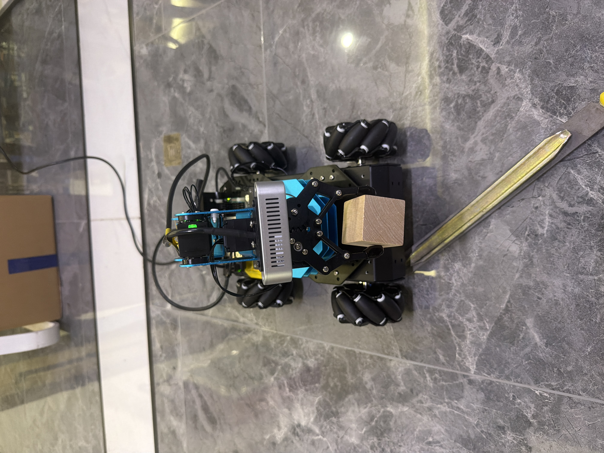

# JCHENG Manipulation

**面向五自由度 ArmPi Ultra 的实测视觉操作：修正模型、自主标定、实机抓取执行与量化可靠性预算。**

[English](README.md) | **简体中文**

> 本项目为应用机器人方向的项目制硕士毕业课题。本仓库是该工作的完整、可追溯记录：修正后的五自由度模型与 TF 树、约束 MoveIt 2 规划、经独立标记验证的自主手眼标定、实机抓取—抬升—放置、安全否决，以及基于实测的失败模式分类。厂商固件与驱动仅作为**只读基线**，不复制进本仓库。

> 历史说明：本仓库最初是一个为期 8 周的 ROS 2 / Panda 学习项目。该记录归档于
> [`docs/archive/README_8WEEK.md`](docs/archive/README_8WEEK.md) 和
> [`docs/weekly-log/`](docs/weekly-log/)；它不属于本毕业课题的结论。早期 Panda
> 与 M2.2 产物仅为可追溯性保留。

**目录：** [项目概览](#项目概览) · [摘要](#摘要) · [目标与贡献](#目标与贡献) ·
[关键结果](#关键结果实机实测) · [系统架构](#系统架构) · [仓库结构](#仓库结构) ·
[项目状态](#项目状态2026-11-21) · [交付清单](#毕业项目交付清单) ·
[快速开始](#快速开始) · [实验方法](#实验方法) ·
[失败分类](#失败模式分类实测) · [安全包络](#安全与运行包络) ·
[局限性](#局限性与有效性威胁) · [证据索引](#可复现性与证据索引) ·
[文档](#文档) · [结论](#结论) · [路线图](#路线图) · [许可证](#许可证)

<p align="center">
  
  <br>
  <em>首次实机抓取（2026-11-18）：机械臂夹住地面上的 39.4 mm 木块。
  全自主抓取—抬升—放置于 2026-11-19 完成。</em>
</p>

## 项目概览

| 项目 | 摘要 |
|---|---|
| **平台** | HiWonder ArmPi Ultra：五自由度机械臂、两指夹爪、麦克纳姆底盘、Raspberry Pi 5、腕部 Aurora 930 RGB-D 相机与底盘前视 RealSense D435i |
| **软件** | 机器人端 ROS 2 Humble；工作站端 ROS 2 Jazzy；MoveIt 2 + Pilz `PTP` + KDL；FastAPI/React 调试台 |
| **核心问题** | 当每一个变换、限位和失效模式都被实测而非假设时，低成本五自由度机械臂加腕部相机能在桌面上实现多精确的操作？ |
| **代表性结果** | 对无标记 39.4 mm 木块完成自主抓取—抬升—放置；预注册 **24 对**试验把成功率从 **12/24 提升到 24/24**（McNemar p = 0.00049），2026-11-21 的**随机落点** 24 对试验在自由摆放点上重复出 **9/24 vs 24/24**（p = 6.1×10⁻⁵）；完整误差预算的平移 **RSS 13.33 mm**（边界未过 6 mm），实测放置均值为 **3.08 mm**；S 曲线运动把抓取+放回从 **11.67 s 降到 8.94 s**；底盘 D435i 与腕部相机 x/y 一致到 **2.58 mm** |
| **证据** | 20+ 个证据包：会话日志、标定数据集、舵机总线记录、Studio 测试报告与机器可读 JSON |
| **状态** | 2026-11-21。实机运动均为受监督执行；正式普查后关节映射在作业包络内为 `verified: true`；机器人没有急停或抱闸 |

## 摘要

本项目研究：当每一个变换、限位和失效模式都被实测而非假设时，低成本五自由度机械臂加腕部 RGB-D 相机能否完成可重复的桌面视觉抓取。ArmPi Ultra 被建模为受约束的五自由度机械臂；相机通过自主实现的棋盘格手眼流程标定到 `link4`（14 个位姿，板位姿一致性 2.94 mm / 0.39°，留出基位姿 3.29 mm / 0.43°）。无标记 RGB-D 分割、关节空间抓取搜索、MoveIt/Pilz `PTP` 执行与独立轨迹否决构成抓取链路。对无标记 39.4 mm 木块进行了 5 轮实机抓取—抬升—放置试验，3 轮成功。第 3、4 轮失败并暴露出低抓取构型下系统性的 −8.0/−15.3/−5.8 mm FK/手眼误差；在该构型下用一次 AprilTag 观测得到修正量后，第 5 轮成功夹住木块、抬升约 148 mm 并释放。随后固定 Tag 普查证明该误差是**常向量**，关节偏置与 `link4` 偏置模型被拟合后**否决**；在 27.9° 偏航下常数模型仍是最近的模型（相差 5.6 mm，夹持关键轴 y 差 3.3 mm），拟合模型相差 14–19 mm。**预注册的 24 对实机试验**把成功率从 12/24 提升到 24/24（McNemar p = 0.00049），配对放置改善 2.19 mm。五个关节已正式手推普查（止挡为姿态相关的自碰撞限位），重复性与回差实测为 0.449 mm RMS 与 1.117 mm，46 次偏移网格测得夹持容差 ±9 mm；夹爪重测将行程从 0.84 rad 修正为 2.22 rad。2026-11-20 又补齐了误差预算的最后三项：抓取执行 **5.386 mm / 1.495° max**（20 次）、夹爪放置 **11.514 mm max / 3.080 mm mean**（20 次放回）、夹具位姿 **14.815 mm 径向 max**（20 次摆放）。完整边界预算为平移 **RSS 13.325 mm / 最坏 24.014 mm**、旋转 **RSS 1.858° / 最坏 3.322°**，边界门限未通过；实测修正后放置均值 **3.080 mm** 仍在 6 mm 内。同日又加入底盘前视 RealSense D435i 作为独立的 `base_link` 观察者（与腕部相机 x/y 一致到 2.58 mm）、把抓取+放回从 11.67 s 降到 8.94 s 的 S 曲线运动；随后两次运行分别加入视野内抓取（4.77 s / 4.44 s，落点 0.92 mm）与 0.464 m 远端木块运行，后者在夹持状态下反向开回原位（相对拟合目标落点误差 11.06 mm，回程本身仍是开环）。2026-11-21 完成了随机落点 24 对试验：操作员每对随手放点、不用量（近的直接夹，远的机器人先开过去）；夹住后机器人把木块**带回起点放下**，操作员从起点拿回同一位置做第二次。机器人用腕相机/底盘 D435i/joint1 扫视定位，成功率 **9/24（原始目标）vs 24/24（常数修正）**（McNemar p = 6.1×10⁻⁵）；回程释放误差因锚点是被修正目标而只作描述性指标。固定 24 点扇形已在采集数据前被取代、未运行。旧流程的一次尝试已丢弃（D1），释放卡滞导致的假阴性另记 D2。本项目的贡献是实测失败模式分类、一项预注册的实机可靠性实验与明确的证据链；2° 旋转门限仍是暂定值。

## 目标与贡献

**项目目标**

1. 重建可信的五自由度模型：关节类型、限位、TF 与相机坐标系均对实机核验。
2. 建立带独立验证的自主标定流程，而不是依赖厂商默认值。
3. 在约束规划与独立安全否决下执行实机视觉抓取。
4. 量化各项误差来源，并识别主导项。
5. 让系统可观测、可复现：每条结论背后都有命令、日志或数据文件。

**主要贡献**

1. **实测模型与坐标系契约。** 修正后的 xacro 模型、实机 TF 核验，以及供 fiducial 定位器使用的实测 body→optical 变换 `camera_optical_calibrated`。
2. **带独立检查的自主标定。** 棋盘格手眼、桌面下俯重标定，以及暴露 4.87% 桌面纵向偏差的实体 AprilTag 尺度测试。
3. **完整的实机抓取链路。** RGB-D 分割 → 约束抓取搜索 → Pilz `PTP` 规划 → 安全否决 → 实测舵机执行 → 验证，并在实机上端到端运行；现已加入 jerk-limited S 曲线路径和底盘相机的否决/验证。
4. **实测低构型误差与被检验模型。** 固定 Tag 普查证明低抓取构型下的 FK/手眼误差是**常向量 (+11.6, +4.0, +8.5) mm**（散布 0.40–0.99 mm），抓取验证修正量为 **(+13.7, +3.9, +8.9) mm**；同一模型在其验证体积内为 2–3 mm。关节偏置与 `link4` 偏置模型虽能拟合 Tag 数据（1.4–2.3 mm RMS），但相对四次成功抓取所用的修正量偏差 **10.6–15.0 mm**，被**否决**。
5. **预注册的配对实机试验。** 24 对匹配试验比较原始 FK/手眼目标与常数修正：**12/24 vs 24/24**（McNemar p = 0.00049），双成功对子的放置误差配对改善 **2.19 mm**（95% CI −3.96…−0.83，p = 0.0063），4 项协议偏差已记录并量化。
   2026-11-21 的**随机落点 24 对**跟进试验（操作员随手放点、底盘先接近）重复了该效应：**9/24 vs 24/24**（McNemar p = 6.1×10⁻⁵）；其回程释放误差的锚点是被修正后的目标，因此只作描述性指标。
6. **完整实测误差预算。** 30 次重复性 **0.449 mm RMS / 1.017 mm max**，回差 **1.117 mm**，46 次抓取容差网格给出 **±9 mm**（保守值 6 mm）；2026-11-20 又测得抓取执行 **5.386 mm / 1.495° max**（20 次）、夹爪放置 **11.514 mm max / 3.080 mm mean**（20 次放回）、夹具位姿 **14.815 mm 径向 max**（20 次摆放）。完整边界预算为平移 **RSS 13.325 mm / 最坏 24.014 mm**、旋转 **RSS 1.858° / 最坏 3.322°**，主导项为放置（74.7%）与执行旋转（64.7%）；实测修正后放置均值 **3.080 mm** 仍在 6 mm 容差内，2° 旋转门限仍为暂定。
7. **安全的关节限位普查。** 以 EEPROM 为界的采纳限位、通电探测到机械止挡，以及规避厂商节点负寄存器崩溃的工具链。
8. **可靠性工具。** 误差预算框架、配对试验记录器与运行器、测量运行器、只读主机/DDS 基准，以及 G1–G6 调试台（后端 93 + 网关 47 个测试）。
9. **证据优先的文档。** 每条量化结论都链接到带时间戳的证据包；Mock、仿真与实机结果严格区分。
10. **独立标定的前视相机。** 底盘前视 RealSense D435i：精化内参（fx = fy 903.5 px，RMS 0.371 px）、实测底盘外参（`[0.136, 0.027, 0.038] m`，俯仰 31.6°）、可跨重启的深度服务、MoveIt 碰撞盒与 Studio 辅助画面。它与腕部相机 x/y 一致到 **2.58 mm**，并证明常数修正是执行补偿而非测量偏差。
11. **更快、更平滑的实测运动。** 用带总线舵机稳定判据的 jerk-limited S 曲线替代单点 6–9 s 运动：抓取+放回从 **11.67 s 降到 8.94 s**（−23%），无木块循环从约 37 s 降到 5.43 s，duty-20 对齐底盘把木块放回原位 **2.22 mm** 内。随后两次运行保持 4.0/20 包络：一次视野内抓取（4.77 s / 4.44 s，落点 **0.92 mm**），一次远端木块运行（294.7 + 32.4 mm 闭环接近、夹持状态下 2.50 s 反向脉冲、相对拟合目标 **11.06 mm** 落点）。

## 关键结果（实机实测）

| 结果 | 实测值 | 证据 |
|---|---|---|
| 手眼标定，14 位姿 | 板位姿一致性 **2.94 mm / 0.39°**；留出基位姿 **3.29 mm / 0.43°**；留一标准差 **3.41 mm / 0.44°** | [`evidence/calibration/20261117/`](evidence/calibration/20261117/) |
| 桌面下俯重标定，15 位姿 | 一致性 **2.7 mm / 0.42°**；留出 **2.2 mm / 0.29°**；留一 **3.1 mm / 0.45°** | [`evidence/calibration/20261118/table_down/`](evidence/calibration/20261118/table_down/) |
| 前视相机标定，D435i | 内参 **fx = fy 903.5 px**，cx/cy 644.9/363.7，RMS **0.371 px**；底盘外参 **[0.136, 0.027, 0.038] m**，俯仰 **31.6°**，偏航 **−1.1°**；板平面度 0.8° | [`evidence/calibration/20261120/`](evidence/calibration/20261120/) |
| 前视相机深度与服务 | 640×480 Z16，**61.5% 有效**，中位数 0.312 m；纯深度 **10.6 Hz**，开彩色时 4–9 Hz；`armpi-rs-depth` + `armpi-ext-cam` 重启后 `NRestarts=0`；IMU 不可用 | [`depth_unblock/`](evidence/calibration/20261120/depth_unblock/README.md)、[`camera_mount.md`](docs/hardware/camera_mount.md) |
| 快速运动，throughput v2（两次运行） | 抓取+放回运动 **11.67 s → 8.94 s（−23%）**；抓取 4.699–4.729 s，释放 4.207–4.259 s；稳定时间 0.14–0.16 s；两次均夹住木块 | [`throughput_v2/`](evidence/phase2/onsite_20261120/throughput_v2/) |
| 快速运动，视野内与远端回程（两次运行） | 视野内：抓取 **4.77 s**、释放 **4.44 s**、落点 **0.92 mm**；0.464 m 远端木块：抓取 **4.76 s**、释放 **4.31 s**，夹持状态下一次 2.50 s 反向脉冲，落点相对拟合目标 **11.06 mm**；均为 4.0/20 | [`fast_motion/`](evidence/phase2/onsite_20261120/fast_motion/) |
| 底盘 duty 20 + 自动对位 | 1.786 s 脉冲 **178.9 mm（100.2 mm/s）**；0.484 s 横移 **45.3 mm**；对齐后木块 (0.2316, −0.0025) m，joint1 0.0065，放回 **2.22 mm** vs 偏航 **6.72 mm** | [`throughput_v2/`](evidence/phase2/onsite_20261120/throughput_v2/) |
| 标定位姿选择 | 从 14,176 个评估位姿 / 3,093 个可行位姿中选出 **24 个**；视角跨度 33.5°；已规划、未执行 | [`evidence/calibration/20261117/pose_selection/`](evidence/calibration/20261117/pose_selection/) |
| 独立 Tag 尺度 | 横向 **100.67 mm vs 100.0 mm（0.67%）**；桌面纵向 **104.87 mm vs 100.0 mm（4.87%）**；夹角 **92.3°** | [`evidence/phase2/onsite_20261118/tag_displacement_validation/`](evidence/phase2/onsite_20261118/tag_displacement_validation/) |
| 深度桌面平面 | **147,626 个内点，RMS 0.7 mm**；桌面 z **−0.0787 m**（深度）vs **−0.0784 m**（215 mm 直尺） | [`evidence/phase2/onsite_20261118/depth_plane_20261118.md`](evidence/phase2/onsite_20261118/depth_plane_20261118.md) |
| 实机抓取试验（第一组） | 39.4 mm 木块的抓取—抬升—放置 **3 / 5** 成功（可行性、非配对） | [`grasp_150mm/`](evidence/phase2/onsite_20261119/grasp_150mm/)、[`attempt2/`](evidence/phase2/onsite_20261119/grasp_150mm_attempt2/)、[`attempt5/`](evidence/phase2/onsite_20261119/grasp_150mm_attempt5/) |
| 最佳自主抬升 | TCP **+0.0993 m**，物体离地 **约 148 mm**；木块 **39.2 × 39.8 mm** | [`attempt5/`](evidence/phase2/onsite_20261119/grasp_150mm_attempt5/) |
| 低构型模型误差 | 固定 Tag：**常数 (+11.6, +4.0, +8.5) mm**，位形散布 **0.40–0.99 mm**；抓取验证修正量 **(+13.7, +3.9, +8.9) mm**，放置残差 **1.3 mm** | [`low_config_error/`](evidence/calibration/20261119/low_config_error/) |
| 低构型模型选择 | 关节偏置 / `link4` 3-DoF / `link4` 6-DoF 都能拟合 Tag 数据（1.4–2.3 mm RMS），但相对已验证修正量偏差 **10.6–15.0 mm**；**支持常数偏置模型** | [`model_selection.md`](evidence/calibration/20261119/low_config_error/model_selection.md) |
| 包络的偏航延伸 | 在 `j1 = 27.9°` 处所需修正为 **(9.14, 7.18, 8.75) mm**；常数偏置相差 **5.6 mm**（夹持关键 y 分量 **3.3 mm**），构型相关模型相差 **14–19 mm** 且 y 反号 | [`yaw_envelope/`](evidence/phase3/onsite_20261119/yaw_envelope/) |
| 配对实机试验，24 对 | **baseline 12/24 vs intervention 24/24**（McNemar **p = 0.00049**）；放置误差 **3.31 mm** vs **4.97 mm**；配对改善 **2.19 mm**（95% CI −3.96…−0.83，**p = 0.0063**） | [`evidence/phase3/onsite_20261119/`](evidence/phase3/onsite_20261119/README.md) |
| 机械臂重复性，30 次 | 径向 **RMS 0.449 mm / 最大 1.017 mm**；关节重复到 0–1 脉冲；Tag 旋转最大 **0.867°** | [`repeatability/`](evidence/phase3/onsite_20261119/repeatability/) |
| 机械臂回差，joint4 ±0.1 rad | 回差 **1.117 mm**（−0.971, −0.064, −0.549 mm）；joint4 落点相差 10 脉冲 | [`backlash/`](evidence/phase3/onsite_20261119/backlash/) |
| 夹爪容差包络，46 次抓取 | 开口方向通过区间 **[-6, +12] mm**（以 +3 mm 为中心 **±9 mm**，即修正量的 y 残余）；`x` 与 `z` 到 **±9 mm** 均无失败；±15 与 −12 均 0/2 | [`envelope/`](evidence/phase3/onsite_20261119/envelope/) |
| 抓取执行，20 次 | 抓取位姿处指令关节角 vs 总线舵机实测：均值 **4.220 mm / 1.069°**，最大 **5.386 mm / 1.495°** | [`trial_report`](evidence/phase3/onsite_20261120/trial_report.md) |
| 夹爪放置，20 次放回 | 落点减抓取前测量：均值 **3.080 mm**，RMS **4.082 mm**，最大 **11.514 mm**；均值偏差 **(−0.99, +1.63) mm** | [`trial_report`](evidence/phase3/onsite_20261120/trial_report.md) |
| 夹具位姿，20 次摆放 | 胶带上径向 **RMS 5.057 mm / 最大 14.815 mm**；每轴 SD **5.112 / 0.884 / 0.362 mm** | [`fixture_report`](evidence/phase3/onsite_20261120/fixture_report.md) |
| 完整误差预算（2026-11-20） | 平移 **RSS 13.325 mm / 最坏 24.014 mm** vs 6 mm；旋转 **RSS 1.858° / 最坏 3.322°** vs 暂定 2°；夹具纳入版 **19.926 mm**；实测放置均值 **3.080 mm** 在 6 mm 内 | [`error_budget.md`](evidence/phase3/onsite_20261120/error_budget.md) |
| 抓取工作半径 | 指垫半径 **205–210 mm**；`joint1` 偏航范围 **±103.2°（206°）** | [`evidence/phase2/onsite_20261119/reach/`](evidence/phase2/onsite_20261119/reach/) |
| 视野外搜索 + 底盘往返 | **+16° `joint1` 偏航**找到 **0.469 m** 处木块；闭环底盘移动 **0.325 m**；抓取并抬升 150 mm；回位残差 **9.4 mm**（地标校验）；放置相对机器人 **1.1 mm** | [`evidence/phase2/onsite_20261119/search_and_return/`](evidence/phase2/onsite_20261119/search_and_return/) |
| 双相机合作抓取，首次（2026-11-20） | 底盘前视 D435i 在 `base_link` 中测得木块，与腕部观察位测量 x/y 相差 **2.58 mm**；仍采用已验证目标 `C_view + e`，因为 `e` 是低构型执行补偿而非测量偏差；双相机确认**夹持成功 + 放回**，前视估计放回平面位移 **3.65 mm** | [`evidence/phase2/onsite_20261120/dual_grasp/`](evidence/phase2/onsite_20261120/dual_grasp/README.md) |
| 最低可达位置 | 物理最低点离地 **10 mm**；名义 TCP 离地 **15 mm**；机械极限为 joint2 322 / joint3 939 | [`evidence/phase2/onsite_20261119/lowest_reach/`](evidence/phase2/onsite_20261119/lowest_reach/) |
| 采纳关节限位 | 舵机 EEPROM **减 20 脉冲**（joint2 低端取实测 322 止挡 → 342），普查后 joint2 上限收紧到 **775**；五个关节 2026-11-19 全部手推实测；`mapping_verified=true`（作业包络） | [`docs/phase2/JOINT_LIMITS.md`](docs/phase2/JOINT_LIMITS.md) |
| 夹爪行程 | **2.22 rad**（张开 −2.22，闭合 0.0）；回差 **约 34 counts**；39.4 mm 木块在 −0.63 夹住 | [`evidence/phase2/onsite_20261118/gripper_stops_20261118/`](evidence/phase2/onsite_20261118/gripper_stops_20261118/) |
| 相机 / DDS | 跨主机 RGB **约 12 Hz**（容器内订阅低估到约 8 Hz）；深度 **8.2 Hz**；ping **0.24 ms** | [`docs/phase3/HOST_BENCHMARK.md`](docs/phase3/HOST_BENCHMARK.md) |
| Studio G5 流对齐检查 | **712 命令 / 711 实测**样本；同索引最大 **0.008321 rad**，RMSE **0.003962 rad**，主要由一个采样周期的起始偏移与脉冲量化造成 | [`evidence/studio_g5/20261118/README.md`](evidence/studio_g5/20261118/README.md) |
| 误差预算（2026-11-19，部分：平移 4/7 来源） | 平移 **RSS 3.995 mm**（通过）/ 最坏 **7.114 mm**（未通过）vs 实测容差 **6 mm**；旋转 **RSS 1.103° / 最坏 1.827°** vs 暂定 2°（均通过）；手眼项占平移 RSS 68%；执行、放置与夹具项当时尚未测量 | [`error_budget_envelope.md`](evidence/phase3/onsite_20261119/error_budget_envelope.md) |

## 系统架构

```text
┌────────────────────────────── 工作站（笔记本）──────────────────────────────────┐
│  MoveIt 2（Humble 容器）     armpi_safety 否决      armpi_analysis                │
│  Pilz PTP / KDL IK           轨迹检查               误差预算、配对试验             │
│  Debug Studio（FastAPI+React）G1–G6、只读网关、G5 记录器                          │
└───────────────────────────────────────┬───────────────────────────────────────────┘
                                        │ CycloneDDS，直连以太网
                                        │ 10.42.0.1 ↔ 10.42.0.218
┌───────────────────────────────────────┴───────────────────────────────────────────┐
│ Raspberry Pi 5 — 厂商 Humble 核心栈 + 前视相机单元                                  │
│ ros_robot_controller · servo_manager · camera · TF · start_node.service            │
│ armpi-rs-depth（D435i 深度）· armpi-ext-cam（D435i 彩色 + TF）                     │
└───────────────┬───────────────────────────────┬───────────────────────────┬────────┘
                │ 6 路总线舵机                  │ 4 路电机通道              │ USB
        机械臂关节 2–6 + 夹爪 1           麦克纳姆底盘（开环）        Aurora 930（腕部）
                                                                      D435i（底盘前视）
```

抓取链路为：

```text
RGB-D 帧
  → 地面/桌面平面拟合
  → 物体掩码 + 体素聚类 + 顶面切片位姿
  → TF 变换到 base_link
  → 约束抓取搜索（位置 + 俯仰 + 腕部滚转 + 接近偏置）
  → 全位姿 KDL IK → FK 校验 → 碰撞检查
  → Pilz PTP 规划（仅规划）
  → /armpi_safety/validate_trajectory
  → jerk-limited S 曲线执行 + 总线舵机实测稳定判据
  → 视角位姿验证（物体已不在原地）
  → 可选前视相机否决 / 放回后检查
```

## 仓库结构

```text
armpi-debug-studio/        # G1–G6 控制台（FastAPI + React）+ 只读/受监督网关
docs/
├── armpi/                 # PRD + G0 厂商审计
├── audit/2026-11-15/      # 源码清单、核对与决策
├── hardware/              # 硬件基线、坐标系契约、网络访问、限位
├── phase0/                # Phase 0 验收、5-DoF 约束、历史审计
├── phase2/                # 标定、抓取搜索、fiducial 桥接、安全、限位、快速运动
├── phase3/                # 误差预算、配对试验、随机落点设计、主机/DDS 基准
├── archive/               # 旧 README/ROADMAP、过期 URDF、8 周记录
└── weekly-log/            # 8 周学习记录
evidence/
├── phase1/                # 实机 Pi/ROS/舵机/TF/相机基线（2026-11-17）
├── calibration/           # 棋盘手眼（20261117）、桌面下俯（20261118）、D435i（20261120）
├── fiducial/              # 合成 + 真实背景 AprilTag 验证
├── armpi_moveit/          # 模型检查、MoveIt 冒烟、Phase 0 日志
├── armpi_grasp/           # Mock 抓取候选搜索（仅规划）
├── phase2/onsite_20261118 # 现场安全、限位、夹爪、首次抓取
├── phase2/onsite_20261119 # 第 1–5 轮抓取、最低可达、偏航包络、控制板探测
├── phase2/onsite_20261120 # 双相机、快速运动、throughput v2
├── phase3/onsite_20261119 # 首次配对试验、重复性、回差、容差包络
├── phase3/onsite_20261120 # 执行/放置/夹具、完整误差预算
├── phase3/onsite_20261120_sites # 固定扇形预注册（已取代、未运行）
├── phase3/onsite_20261121_random # 随机落点 24 对试验（9/24 vs 24/24，2026-11-21）
└── studio_g*/             # G2–G6 测试与实机证据
ros2_ws/src/
├── armpi_ultra_description/    # 5-DoF xacro + 夹爪 + 相机坐标系
├── armpi_ultra_moveit_config/  # MoveIt 配置（Mock + 实机 launch）
├── armpi_fiducial_localizer/   # AprilTag/ArUco 目标定位
├── armpi_grasp_planner/        # 5-DoF 候选生成 + 桥接 + Mock E2E
├── armpi_safety/               # 状态看门狗 + 轨迹否决
├── armpi_analysis/             # 误差预算、配对试验、主机基准
├── arm_basics/                 # 历史学习节点
├── arm_description/            # 2-DOF simple_arm + M2.2 控制器配置
├── arm_interfaces/             # 自定义 action + 轨迹校验服务
└── arm_moveit_demo/            # Panda 抓取放置演示
tools/
├── humble_moveit/         # 实机使用的 Humble Docker MoveIt/RViz
├── phase1/                # 实机基线辅助工具
├── phase2/                # 标定、分割、抓取、快速运动、限位、安全工具
├── phase3/                # 配对试验、快速运动、随机落点运行器
└── phase4/                # 只读主机/DDS 基准采集
```

## 项目状态（2026-11-21）

实机结果截至 2026-11-20；本文档于 2026-11-21 与路线图、变更日志和验收报告同步。状态约定：**已实现 / 已验证 / 进行中 / 计划中**。`已验证` 表示 `evidence/` 中存在命令、日志或数据文件；它本身不代表完成硬件验证。厂商功能单独标注。

| 工作流 | 状态 | 证据 / 限制 |
|---|---|---|
| 机器人模型与 TF | **已实现；实机 TF 已验证** | 修正 xacro；`check_urdf`；实机 `base_link → rgb_camera_link` / `depth_camera_link`；实测光学坐标系；前视 `base_link → ext_cam_optical` |
| ArmPi MoveIt 2 | **已实现；Mock + 实机执行验证** | KDL 全位姿 IK；关节空间规划 `error_code=1`；6D 约束 Pilz `PTP`；实机使用 Humble Docker MoveIt；D435i 作为 MoveIt 碰撞盒 |
| 手眼标定 | **已验证** | 腕部 14 位姿棋盘 2.94 mm / 0.39°，留出 3.29 mm / 0.43°，桌面下俯 2.7 mm / 0.42°；前视 D435i 内参 903.5 px / RMS 0.371 px、底盘外参俯仰 31.6° |
| 前视相机（D435i） | **已验证，有限制** | 底盘前视 USB 3.0；彩色 UVC 1280×720，深度 640×480 Z16 约 62% 有效 / 纯深度 10.6 Hz；`armpi-rs-depth` + `armpi-ext-cam` 干净启动；IMU 不可用；深度从约 0.2 m 起，抓取带只有彩色 |
| Fiducial 定位 | **已验证（合成 + 真实背景 + 实体 Tag）** | 合成 5/5（最大 1.82 mm / 1.49°）；半合成 15/15（最大 1.69 mm / 0.53°）；8 帧真实图像 0 误检；实体 Tag 横向尺度 0.67% |
| 约束抓取搜索 | **已实现；Mock + 实机使用** | Mock：80 候选 → 40 IK → 26 无碰撞 → 3 条规划；每轮实机抓取均使用该搜索 |
| 实机视觉抓取 | **已验证：第一组 3/5；加修正后 24/24；双相机 PASS** | 第 1、2、5 轮建立链路；第 3–4 轮暴露低构型误差；24 对试验测得 12/24（原始目标）vs 24/24（修正后）；D435i 与腕部 x/y 一致到 2.58 mm，并验证一次夹持+放回 |
| 快速运动 | **实机验证（4.0/20 包络下四次木块运行）** | jerk-limited S 曲线 + 总线舵机稳定判据；抓取+放回 **11.67 s → 8.94 s（−23%）**；默认 4.0/20；duty-20 底盘 100.2 mm/s；对齐自动对位放回 2.22 mm；后续视野内/远端运行抓取 4.77/4.76 s，`--return-home` 在夹持下反向 245.3 mm 接近（相对拟合目标落点 11.06 mm） |
| 关节限位 | **2026-11-19 正式普查；2026-11-20 热更新运行栈；`mapping_verified=true`** | 五个关节全部手推实测（释放扭矩）；止挡为姿态相关的自碰撞限位；joint2 上限 810→775，并已在 move_group/safety/Studio 生效 |
| 无头抓取工具链 | **已验证** | `grasp_150mm` 工具、`moveit_execute`、`pulse_move`、`fast_motion`/`fast_motion_e2e`；每条机械臂规划均经安全否决 |
| 安全层 | **已实现；Mock 验证 + 实机否决** | 看门狗、关节/速度/加速度/起始状态/时长/工作空间检查；桌面平面间隙；D435i 碰撞盒（仅 MoveIt）；无急停或抱闸 |
| 测量协议 | **已实现；误差预算来源已实测** | 30 次重复性 0.449 mm RMS / 1.017 mm max；回差 1.117 mm；46 次容差网格（开口轴 ±9 mm）；20 次执行 5.386 mm / 1.495° max；20 次放置 11.514 mm max / 3.080 mm mean；20 次夹具位姿 14.815 mm 径向 max；旋转容差与视觉位移运行器已加入，实机运行待做 |
| 误差预算 | **已完成；边界门限未通过** | 全部误差源已测；平移 RSS 13.325 mm / 最坏 24.014 mm vs 6 mm；旋转 RSS 1.858°（通过）/ 最坏 3.322°（未通过）vs 暂定 2°；实测修正后放置均值 3.080 mm 在 6 mm 内；夹具纳入版 RSS 19.926 mm |
| 配对试验 | **两次实机试验完成（2026-11-19 固定点、2026-11-21 随机落点）** | 2026-11-19：24 对，baseline 12/24 vs intervention 24/24，McNemar p = 0.00049；12 个双成功对子中干预放置误差低 2.19 mm（95% CI −3.96…−0.83，p = 0.0063）。2026-11-21 随机落点：自由摆放 + 底盘接近，baseline **9/24** vs intervention **24/24**，McNemar **p = 6.1×10⁻⁵**；回程释放误差（锚点=修正目标，+2.12 mm）只作描述；baseline MISS 14 + NO_GRIP 1（回程中掉落）；D1/D2 丢弃已记录；到达后到抓取的 gap 修复为采集后工具变更 |
| 主机/DDS 基准 | **已实现；只读实机快照** | 笔记本 + Pi 指标；状态 20 Hz；相机约 12 Hz；ping 0.24 ms |
| Debug Studio | **G1–G6 已实现；测试通过** | 后端 93 + 网关 47；Mock 10 + 硬件 3 个 Playwright；G5 运动采集；G6 受监督路径无运动验证；Dashboard 增加 D435i 辅助画面 |
| 时钟同步 | **已实现并验证** | 笔记本 systemd user timer 每 60 s 推送；受限 forced-command 密钥；Pi 保持约 2 s 领先；强制落后 301 s 后恢复；重启测试 PASS |
| 控制板 | **已探测（2026-11-19）** — 电池、6 路总线舵机、4 路开环电机占空比、蜂鸣器与 LED1/2 为真实功能；IMU、编码器、急停、板载手柄/SBUS 不存在；KEY1/2 已拆除 | [`evidence/phase2/onsite_20261119/board_capabilities/`](evidence/phase2/onsite_20261119/board_capabilities/) |
| 移动底盘 | **仅开环；duty-20 自动接近已验证** | 4 路电机占空比，无编码器/IMU/里程计；0.5 s 看门狗；任何底盘运动都会使桌面标定失效；一次对齐自动对位落在 (0.2316, −0.0025) m |

历史学习路线：Panda 抓取放置演示（`arm_moveit_demo`）与 M2.2 双自由度控制器
配置（`arm_description`）属于归档的学习产物，证据在
[`evidence/m2_2_v2/`](evidence/m2_2_v2/) 与 [`docs/archive/`](docs/archive/)；
它们不属于本毕业课题的结果。

## 毕业项目交付清单

- [x] 问题定义、范围与平台约束
- [x] 修正模型、TF 树与实测相机坐标系
- [x] 自主标定与独立验证
- [x] 约束规划与抓取候选搜索
- [x] 安全否决下的实机执行
- [x] 带逐轮证据的量化结果
- [x] 失败模式分类与批判性分析
- [x] 可复现命令与测试套件
- [x] 完整误差预算（2026-11-20）——全部误差源已测；边界聚合未通过（平移 RSS 13.325 mm、旋转最坏 3.322°），但实测放置均值（3.080 mm）在 6 mm 内；2° 旋转门限仍为暂定
- [x] 具备统计功效的配对实机试验（2026-11-19）：24 对，McNemar p = 0.00049，配对放置改善 2.19 mm（p = 0.0063）
- [x] 低构型模型标定（2026-11-19）——关节偏置假设被否决，实测包络内支持常数偏置
- [x] 正式机械限位测量与 `mapping_verified=true`（2026-11-19；止挡与姿态相关，按作业包络认定）
- [x] 独立标定的底盘前视 D435i、深度服务、MoveIt 碰撞盒与双相机抓取验证（2026-11-20）
- [x] jerk-limited 快速运动与总线舵机稳定判据（2026-11-20）：抓取+放回 11.67 s → 8.94 s，对齐自动对位放回 2.22 mm；4.0/20 包络下四次木块运行，含远端回程运行（抓取 4.76 s，相对拟合目标落点 11.06 mm）
- [x] 随机落点 24 对试验（2026-11-21）：自由摆放 + 底盘接近，baseline 9/24 vs intervention 24/24（McNemar p = 6.1×10⁻⁵）；回程释放指标仅作描述

## 快速开始

### 环境要求

- 工作站 ROS 2 Jazzy；机器人 ROS 2 Humble + CycloneDDS。
- Humble MoveIt/RViz 的 Docker 容器（`tools/humble_moveit/`）。
- Python 3.10+、Node 20+（调试台）。
- 实机运行还需：直连以太网、厂商 `start_node.service`、D435i 的
  `armpi-rs-depth` / `armpi-ext-cam` 单元，以及
  [`docs/hardware/network_access.md`](docs/hardware/network_access.md) 中的网络锁定。

### 构建与测试

```bash
source /opt/ros/jazzy/setup.bash
cd ros2_ws
colcon build --symlink-install

# 纯 Python CI：误差预算、配对试验、基准、测量、分割
python -m pytest -q \
  ros2_ws/src/armpi_analysis/test/test_error_budget.py \
  ros2_ws/src/armpi_analysis/test/test_paired_trials.py \
  ros2_ws/src/armpi_analysis/test/test_host_benchmark.py \
  tools/phase2/tests/test_grasp_joint_fit.py \
  tools/phase2/tests/test_low_config_model_fit.py \
  tools/phase2/tests/test_measurement_protocol.py \
  tools/phase2/tests/test_object_segment.py \
  tools/phase3/tests \
  tools/phase4/tests

# 调试台：后端 93、网关 47、Mock Playwright 10
cd armpi-debug-studio/backend && pytest
cd ../ros2_gateway && pytest
cd ../frontend && npm run test:e2e
```

### Mock 链路（无硬件）

```bash
source /opt/ros/jazzy/setup.bash
source ros2_ws/install/setup.bash

# 模型 + MoveIt Mock
xacro ros2_ws/src/armpi_ultra_description/urdf/armpi_ultra.xacro > /tmp/armpi.urdf
check_urdf /tmp/armpi.urdf
ros2 launch armpi_ultra_moveit_config demo.launch.py \
  ros2_control_hardware_type:=mock_components \
  use_sim_time:=false use_gazebo:=false use_real:=false

# 6D 约束目标（仅规划）
python3 tools/phase0/constrained_plan_check.py \
  --pipeline pilz_industrial_motion_planner --planner PTP

# fiducial → 抓取 → 安全 E2E，隔离域 77
tools/phase2/run_mock_visual_grasp_e2e.sh evidence/phase2/session3_20261117
```

### 实机运行（仅受监督）

实机流程刻意不提供一条可直接复制执行的命令。必需步骤见：

- [`docs/hardware/network_access.md`](docs/hardware/network_access.md) — 有线链路、防火墙、网关绑定。
- [`tools/humble_moveit/README.md`](tools/humble_moveit/README.md) — Humble MoveIt/RViz 容器与 CycloneDDS。
- [`docs/phase2/JOINT_LIMITS.md`](docs/phase2/JOINT_LIMITS.md) — 采纳限位、测量与恢复规则。
- [`docs/phase2/SAFETY_LAYER.md`](docs/phase2/SAFETY_LAYER.md) — 否决服务与运行包络。
- [`docs/hardware/camera_frames.md`](docs/hardware/camera_frames.md) — body 与 optical 坐标系、`camera_optical_calibrated`。
- [`docs/hardware/camera_mount.md`](docs/hardware/camera_mount.md) — Aurora 坐标系，以及底盘前视 D435i 的安装、标定、服务与限制。
- [`docs/phase2/FAST_MOTION.md`](docs/phase2/FAST_MOTION.md) — S 曲线、实测稳定判据与 4.0/20 包络。
- [`docs/phase3/RANDOM_SITE_DESIGN.md`](docs/phase3/RANDOM_SITE_DESIGN.md) — 已完成的随机落点 24 对试验（9/24 vs 24/24）；固定扇形设计已在采集数据前被取代。

2026-11-19 的抓取使用 `tools/phase2/real_moveit_execute.py`、
`tools/phase2/object_segment_rgbd.py`、`tools/phase2/depth_plane_fit.py`
以及 Studio G5/G6 路径；详见
[`evidence/phase2/onsite_20261119/`](evidence/phase2/onsite_20261119/)。
2026-11-20 又加入 `tools/phase2/fast_motion.py`、
`tools/phase3/fast_motion_e2e.py`（throughput v2、对齐自动对位，以及远端回程的
`--return-home`）和 `ext_cam_*` 前视相机链路；详见
[`evidence/phase2/onsite_20261120/`](evidence/phase2/onsite_20261120/)。

### 离线分析（不运动）

```bash
# 误差预算：2026-11-20 完整流水线预算
PYTHONPATH=ros2_ws/src/armpi_analysis python3 -m armpi_analysis.error_budget \
  --input ros2_ws/src/armpi_analysis/config/error_budget_onsite_20261120.json \
  --markdown-out /tmp/error_budget.md

# 夹具纳入版
PYTHONPATH=ros2_ws/src/armpi_analysis python3 -m armpi_analysis.error_budget \
  --input ros2_ws/src/armpi_analysis/config/error_budget_fixture_20261120.json \
  --markdown-out /tmp/error_budget_fixture.md

# 配对试验：计划、合成运行、分析
PYTHONPATH=ros2_ws/src/armpi_analysis python3 -m armpi_analysis.paired_trials \
  plan --pairs 24 --seed 7 --json-out /tmp/paired_plan.json
PYTHONPATH=ros2_ws/src/armpi_analysis python3 -m armpi_analysis.paired_trials \
  analyze --input /tmp/paired.jsonl --markdown-out /tmp/paired.md

# 只读主机/DDS 基准
tools/phase4/run_benchmark.sh evidence/phase3/session4_20261117/with_camera
```

## 实验方法

### 标定

相机安装在 `link4` 上、位于最终腕部旋转之前，因此标定的是 `link4 → camera`，而不是直接的夹爪→相机变换。棋盘采集使用舵机实测位置而非命令回显。验证采用三种独立程序：板位姿一致性、留出基位姿与留一交叉验证。桌面下俯采集针对实际工作视角重新拟合变换，实体 AprilTag 提供独立尺度检查。厂商手眼矩阵对当前安装已过期，**不**作为 Baseline A。底盘前视 D435i 单独标定：平板与斜靠棋盘扫描给出 `fx = fy 903.5 px`、RMS 0.371 px；同一块板在验证过的桌面下俯位姿同时被两台相机看到，解出 `base_link → ext_cam_optical` = `[0.136, 0.027, 0.038] m`，俯仰 31.6°、偏航 −1.1°；平板检查与深度平面估计在声明的误差内一致。

### 抓取

物体不使用标记：地面平面 RANSAC、体素聚类与顶面切片拟合给出位置、尺寸和偏航。约束抓取搜索在五自由度可达集内采样，筛选全位姿 IK、校验 FK、检查碰撞，并用 Pilz `PTP` 规划。独立安全节点在执行前否决轨迹。执行以舵机实测完成判定，而不是命令回显。只有物体在已验证视角下从地面消失，才判定抓取成功；安装在运动臂上的相机离被夹物体太近，不能作为可靠的夹持传感器。D435i 提供独立的 `base_link` 测量：与腕部测量相差超过 8 mm 时可否决，并可验证夹持后/放回后的状态，但它**不能**替代常数低构型修正——双相机运行证明该修正是执行补偿，不是视角位姿的测量偏差。

运动使用 jerk-limited 关节空间 S 曲线（`motion_profile.py`），以密集 waypoint 发给厂商 action server；每次运动都以总线舵机实测稳定判据结束（0.12 s 内无寄存器移动超过 3 counts）。生产默认为 `vmax = 4.0 rad/s`、`amax = 20 rad/s²`；夹持木块的释放下降为 1.4 rad/s。`--slow` 恢复旧版单点定时。

### 关节限位与安全

限位按舵机 EEPROM 减 20 脉冲（0.0838 rad）采纳。2026-11-19 的正式普查在竖直位姿逐个关节释放扭矩手推实测（joint2 另在低位作业位姿测了一次）：止挡是**自碰撞限位、随姿态变化**（joint2 低位 795 / 竖直 873；joint3 939 / 923），因此静态限位按作业包络认定，其余姿态由 MoveIt 的自碰撞检查兜底；joint2 上限收紧到低位手推止挡（775 脉冲）。夹爪在发现原始张开值只是卡滞而非止挡后重新测量。厂商节点在读到负舵机寄存器时会因 `uint16` 断言崩溃，因此所有测量运动单调推进，并带自由下落中止保护。

### 模型与规划注意事项

- 仓库默认使用 KDL 全位姿 IK（`position_only_ik: false`）；未安装 TRAC-IK。
  仅位置可达性检查使用单独配置。
- 约束目标使用 Pilz `PTP`：OMPL 的目标采样器在 KDL 下无法求解该 6D 目标，
  而 `LIN` 会离开五自由度可达集。
- 厂商预生成的 URDF 已归档；只使用 xacro。
- 厂商手眼矩阵对当前安装已过期，不作为 Baseline A。

### 可靠性分析

误差预算框架区分已测与未测来源，报告 RSS、最坏情况、主导项与 Monte Carlo 区间。配对试验记录器采用追加式 JSONL、带种子的对内随机化与精确配对检验；预注册的 24 对试验是它首次实机使用。运动项用**固定 AprilTag** 测量（重复性、回差、偏航延伸）；**容差**来自 46 次偏移网格，且每次放置都经过木块高度/尺寸与朝向门控，确保测的是夹持容差而不是几何。2026-11-20 又用受监督运行器补测三项：**执行**比较抓取位姿处指令关节角与总线舵机实测，**放置**取分割落点减抓取前测量，**夹具位姿**取 20 次人工摆放的散布。另加入两个尚未运行的运行器：`joint5` 腕部偏航旋转容差扫描，以及把直尺未知偏航作为 nuisance 参数拟合的直尺夹具视觉位移网格。主机/DDS 基准为只读，测量两端主机的 topic 速率、抖动与消息年龄。除显式受监督的运行器外，没有测量工具会命令抓取。

## 失败模式分类（实测）

| # | 发现 | 后果 | 状态 |
|---|---|---|---|
| 1 | 夹爪“张开”值 −0.8378 rad 是卡滞，不是连杆止挡 | 手指只张开约 60%，木块可能卡住 | **已修复**：行程重测为 2.22 rad |
| 2 | FK/手眼误差与构型相关：低抓取位姿为 −8.0/−15.3/−5.8 mm，桌面下俯为亚毫米 | 第 3–4 轮在木块旁闭合 | **已缓解**：单点 Tag 修正；根因待解 |
| 3 | 深度相机近端截止 0.176 m；低构型下物体距相机 72 mm | “物体位于视野中心”门控物理上不可行 | **已记录**；目标改由桌面下俯视角提供 |
| 4 | 用距被夹物体 0.10 m 的相机判断夹持 | 第 3–4 轮出现错误的“已夹住”证据 | **协议已修复**：在视角位姿检查地面原位 |
| 5 | 地面可达边界使 TCP 沿手指方向差 5.9 mm | 抓取位于工作空间边缘 | **已知**；使用深关节族 |
| 6 | 负舵机寄存器使厂商 `get_state` 回调崩溃 | 限位测量期间 4 次节点崩溃 | **已缓解**：单调测量、自由下落中止、绝不读负值 |
| 7 | 机器人无 RTC、无 NTP；`/joint_states` 到达即过期 | MoveIt 在运动前中止 | **已操作修复**：笔记本每 60 s 推送时钟，Pi 保持约 2 s 领先；受限 forced-command 密钥 |
| 8 | AprilTag 尺寸错误（估计 73 mm，实际 60 mm） | Tag 被放到地面以下 59 mm | **已修复**：用直尺实测尺寸 |
| 9 | `armpi_safety` 拒绝仅夹爪轨迹（“FK failed: joint1”） | MoveIt 无法 `--execute` 夹爪动作 | **未解决**；夹爪走 `/gripper_controller` |
| 10 | 底盘运动使桌面标定失效；无里程计/IMU | 任何底盘移动后必须重标定 | **已知**；移动扩展单列 |
| 11 | 2026-11-19 文件修改后，运行中的 move_group/safety/Studio 仍持有 joint2 旧上限 1.2985 rad | 可能指令到普查前区域 | **2026-11-20 已修复**：symlink 重建并重启三个进程；joint2 = 1.2 被拒绝 |
| 12 | D435i 深度被 D400 HID gate 拦住（内核无 `CONFIG_HID_SENSOR_HUB`） | UVC/libusb 能看到相机，但 `rs2::context` 报告 0 设备 | **已修复**：本地 librealsense 补丁接受无 HID 传感器；IMU 仍不可用 |
| 13 | D435i 碰撞盒是 planning-scene 对象，不是 URDF link | 直接关节运动与 `armpi_safety` 绕过它 | **已知**：MoveIt 重启后需重新发布；低/非计划运动保持目视检查 |

## 安全与运行包络

- **没有急停、没有抱闸。** 断电会使机械臂下落；厂商栈约 89 s 自动恢复。所有运动均受监督。
- **采纳限位是可指令限位，不是机械保证。** 2026-11-19 普查后 `mapping_verified=true`，但止挡是姿态相关的自碰撞限位；后端与 Studio 仍默认关闭运动。
- **绝不读取或指令负舵机寄存器。** 它会使厂商节点崩溃；恢复时的节点重启本身就会移动机械臂。
- **MoveIt 执行需要时钟领先。** 笔记本 systemd user timer 每 60 s 推送一次，通过受限 forced-command 密钥让 Pi 保持约 2 s 领先；跨主机执行前先确认 timer 状态。
- **`/joint_states` 是命令回显。** 最接近的厂商反馈是 `/controller_manager/servo_states`；独立的硬件读数是 `get_state` 服务。2026-11-18 的 G5 采集显示 `servo_states` 可能与命令回显完全一致，因此应把它视为舵机上报值，而不是独立计量。
- **低构型对两台相机都是深度盲区。** 腕部近端截止 0.176 m；前视 D435i 深度从约 0.2 m 开始，抓取带只有彩色；不要从低视角做深度抓取。
- **前视相机不是 URDF link。** 90×25×26 mm 碰撞盒只是 MoveIt planning-scene 对象；直接关节运动与 `armpi_safety` 绕过它。MoveIt 重启后重新发布，低/非计划运动保持目视检查。
- **快速运动受实测包络约束。** 默认 4.0 rad/s / 20 rad/s²，夹持木块下降 1.4 rad/s；`--slow` 恢复旧定时。每次运动都以总线舵机实测稳定判据验收。
- **入站只走有线链路。** 默认拒绝的 nftables，仅允许 `eth0`，SSH 仅密钥，网关绑定 `10.42.0.218`。
- **没有自主运行。** G6 路径为单关节、步长受限，并要求显式确认短语。

## 局限性与有效性威胁

- **单一平台、单一物体、单一会话。** 24 对试验给出的是该夹具、该木块、该电池状态下的效应，不是总体成功率估计；连续误差比较以 baseline 也成功的 12 对为条件。
- **低构型修正是有包络的。** 固定 Tag 普查证明它在实测包络内是常数（散布 0.40–0.99 mm）；关节偏置与 `link4` 偏置模型把修正量预测偏差 10.6–15.0 mm 并被否决。偏航延伸实验把包络测到 `j1 ≈ 0.5 rad`：该处所需修正 (9.14, 7.18, 8.75) mm，常数差 5.6 mm，拟合模型差 14–19 mm 且 y 反号。
- **误差预算完整但边界门限未通过。** 全部误差源已测；平移边界 RSS 13.325 mm、旋转最坏 3.322° 均超过 6 mm / 2° 门限，而实测修正后放置均值（3.080 mm）在 6 mm 内。2° 旋转门限仍是暂定值，夹具是沿径向的胶带线而非带 x 向挡块的可重复夹具。
- **前视相机是单次验证且有硬限制。** 只完成一次双相机抓取；深度从约 0.2 m 开始（抓取带只有彩色），本内核上 IMU 不可用，碰撞盒只保护 MoveIt 规划。2.58 mm 的 x/y 一致不是计量级结论。
- **快速运动在 4.0/20 包络下验证了四次运行。** 11.67 s → 8.94 s 与 2.22 mm 对齐放回来自同一地面位置、同一电池状态下的两次受监督运行；后续两次加入视野内抓取（落点 0.92 mm）与远端木块运行（0.464 m，相对拟合目标落点 11.06 mm）。`--return-home` 仍是开环：2026-11-19 测得 32.1 mm 回程误差，一次修正后为 9.4 mm，因此远端落点是基座坐标系下的放置误差，不是回程误差；更早的 5.45 s 运行使用旧的 3.0/12 默认值。
- **随机落点后续已完成。** 2026-11-21 的 24 对试验在自由摆放点上得到 baseline 9/24 vs intervention 24/24（McNemar p = 6.1×10⁻⁵），因此配对抓取结论不再依赖单一夹具摆放；但它的连续指标是“起点释放误差”（锚点=修正目标），与 2026-11-19 的原地放回指标不可混用。旧流程一次尝试已丢弃（D1），释放卡滞导致的假阴性记 D2。前视相机远场（0.46–0.55 m）仍是链路中验证最少的一环。
- **48° 斜视下绝对深度有偏。** RGB 与深度在该视角相差约 40–50 mm；桌面下俯与深度平面估计才是可靠参考。
- **手眼验证是板相对的。** 它证明一致性而非绝对计量；Tag 尺度检查是独立的物理锚点。
- **关节限位已正式普查但依赖姿态。** 五个关节在 2026-11-19 释放扭矩手推实测；止挡是自碰撞限位，`mapping_verified=true` 仅覆盖作业包络。
- **无力/力矩传感、无急停、无抱闸。** 接触丰富操作与自主恢复不在范围内。
- **Mock 与 Gazebo 结果从不作为硬件验证。** `mock_components` 与合成标记只验证软件路径。

## 可复现性与证据索引

本 README 中的每条量化结论都可追溯到以下证据包之一：

| 领域 | 证据 |
|---|---|
| 硬件基线 | [`evidence/phase1/20261117/`](evidence/phase1/20261117/)、[`docs/hardware/README.md`](docs/hardware/README.md) |
| 模型 / MoveIt | [`evidence/armpi_moveit/`](evidence/armpi_moveit/)、[`docs/phase0/PHASE0_ACCEPTANCE.md`](docs/phase0/PHASE0_ACCEPTANCE.md) |
| 标定 | [`evidence/calibration/20261117/`](evidence/calibration/20261117/)、[`evidence/calibration/20261118/table_down/`](evidence/calibration/20261118/table_down/)、[`evidence/calibration/20261120/`](evidence/calibration/20261120/)（D435i） |
| Fiducial | [`evidence/fiducial/20261116/`](evidence/fiducial/20261116/)、[`evidence/phase2/real_background_20261117/`](evidence/phase2/real_background_20261117/) |
| 抓取搜索 | [`evidence/armpi_grasp/20261116/`](evidence/armpi_grasp/20261116/) |
| 现场安全 / 限位 | [`evidence/phase2/onsite_20261118/`](evidence/phase2/onsite_20261118/) |
| 实机抓取 / 可达 | [`evidence/phase2/onsite_20261119/`](evidence/phase2/onsite_20261119/)、[`evidence/phase2/onsite_20261120/`](evidence/phase2/onsite_20261120/)（双相机、快速运动、throughput） |
| 可靠性分析 | [`evidence/phase3/onsite_20261119/`](evidence/phase3/onsite_20261119/README.md)（配对试验、重复性、回差、容差网格、偏航包络、误差预算）；[`evidence/phase3/onsite_20261120/`](evidence/phase3/onsite_20261120/README.md)（执行、放置、夹具、完整预算）；[`evidence/phase3/onsite_20261121_random/`](evidence/phase3/onsite_20261121_random/README.md)（随机落点 24 对试验，9/24 vs 24/24；固定扇形 [`onsite_20261120_sites/`](evidence/phase3/onsite_20261120_sites/README.md) 已在采集数据前被取代）；框架基线 [`evidence/phase3/session4_20261117/`](evidence/phase3/session4_20261117/) |
| 关节限位 | [`evidence/phase2/onsite_20261119/joint_limits/`](evidence/phase2/onsite_20261119/joint_limits/README.md) |
| 时钟 / 网络 | [`docs/hardware/ros_environment.md`](docs/hardware/ros_environment.md)、[`docs/hardware/network_access.md`](docs/hardware/network_access.md) |
| Studio G1–G6 | [`evidence/studio_gateway/`](evidence/studio_gateway/)、[`studio_g2/`](evidence/studio_g2/)、[`studio_g3/`](evidence/studio_g3/)、[`studio_g4/`](evidence/studio_g4/)、[`studio_g5/`](evidence/studio_g5/)、[`studio_g6/`](evidence/studio_g6/) |
| 安全加固 | [`evidence/security/20261118/`](evidence/security/20261118/) |

仓库保留原始日志与机器可读 JSON；当图像是主要证据时也会保留。`*.mcap` bag 已 gitignore，需单独备份。`evidence/README.md` 说明了跟踪范围。

## 文档

- [技术路线图](ROADMAP.md) — 公开技术路线图与后续步骤。
- [变更日志](CHANGELOG.md) — 按会话记录的时间顺序变更。
- [验收报告](docs/phase0/PHASE0_ACCEPTANCE.md) — Phase 0 检查清单、当前毕业项目验收结论与剩余缺口。
- [5-DoF 约束](docs/phase0/ARMPI_5DOF_CONSTRAINTS.md) — 任务空间限制与抓取策略。
- [标定](docs/phase2/CALIBRATION.md) — 棋盘手眼流程与验证结果。
- [标定位姿选择](docs/phase2/CALIBRATION_POSES.md) — 离线 24 位姿选择。
- [抓取候选搜索](docs/phase2/GRASP_CANDIDATE_SEARCH.md) — 候选生成与筛选。
- [Fiducial 定位](docs/phase2/FIDUCIAL_TARGET_LOCALIZATION.md) — AprilTag 位姿约定与验证。
- [Fiducial → 抓取桥接](docs/phase2/FIDUCIAL_GRASP_BRIDGE.md) — TF、搜索与安全否决。
- [安全层](docs/phase2/SAFETY_LAYER.md) — 看门狗、限位与否决。
- [测量协议](docs/phase2/MEASUREMENT_PROTOCOL.md) — 重复性、回差、视觉位移、夹爪包络。
- [关节限位](docs/phase2/JOINT_LIMITS.md) — 测量、EEPROM 边界与恢复规则。
- [快速运动](docs/phase2/FAST_MOTION.md) — S 曲线、实测稳定判据与 4.0/20 包络。
- [误差预算](docs/phase3/ERROR_BUDGET.md) — schema、2026-11-20 完整预算与边界门限失败。
- [配对试验](docs/phase3/PAIRED_TRIALS.md) — 记录器、随机化与分析；设计预注册在
  [PAIRED_TRIAL_DESIGN.md](docs/phase3/PAIRED_TRIAL_DESIGN.md)。
- [随机落点 24 对试验](docs/phase3/RANDOM_SITE_DESIGN.md) — 已完成的区域、定位链路、包络守卫与分析（9/24 vs 24/24）；早先的[固定扇形设计](docs/phase3/SITE_DIVERSITY_DESIGN.md)已在采集数据前被取代。
- [主机/DDS 基准](docs/phase3/HOST_BENCHMARK.md) — 只读指标与相机速率修正。
- [相机安装](docs/hardware/camera_mount.md) — Aurora 腕部相机，以及底盘前视 D435i 的安装、标定、服务与深度限制。
- [相机坐标系契约](docs/hardware/camera_frames.md) — body 与 optical。
- [ROS 环境](docs/hardware/ros_environment.md) — 主机/容器、DDS 与 2026-11-20 时钟同步 timer。
- [网络访问](docs/hardware/network_access.md) — 有线链路与安全锁定。
- [厂商标定基线](docs/hardware/vendor_calibration_baseline.md) — 矩阵解码与 Baseline A 状态。
- [2026-11-15 审计](docs/audit/2026-11-15/README.md) — 来源、冲突、状态与决策。
- [Debug Studio PRD](docs/armpi/ARMPI_DEBUG_STUDIO_PRD_V1.md)
- [G0 厂商审计](docs/armpi/g0/README.md)
- [8 周学习日志](docs/weekly-log/)

`MASTER_PLAN_V3_PRIVATE.md` 有意**不**放入这个公开仓库。

## 结论

本工作支持一个范围有限但有意义的结论：在该平台上，借助实测标定、约束规划与安全否决，可以对无标记 39.4 mm 木块完成自主抓取—抬升—放置；主要残余误差来自运动学，而不是感知。第 1–2 轮建立了完整链路；第 3–4 轮定位了低构型模型误差；固定 Tag 普查证明它在实测包络内是常数，并用抓取验证到 1.3 mm；随后又用同一批数据否决了关节偏置与 `link4` 偏置模型。预注册的 24 对实机试验随后完成：抓取成功率从 12/24 提升到 24/24（McNemar p = 0.00049），双成功对子的放置误差配对改善 2.19 mm（p = 0.0063）。2026-11-21 的随机落点 24 对试验在自由摆放点上重复了配对效应（9/24 → 24/24，p = 6.1×10⁻⁵）。次日（2026-11-20）又加入独立标定的第二台相机、快 23% 的实测运动路径与完整误差预算。同一批证据也说明了尚未解决的部分：修正是常数而非构型相关模型，且在实测包络之外未验证；完整边界预算（RSS 13.325 mm）未通过 6 mm 容差，尽管实测放置均值（3.080 mm）在容差内，尾部与旋转门限仍是开放风险；随机落点的连续指标受修正锚点影响，不能作为放置精度提升的证据；单会话结果不足以支撑总体可靠性结论。

## 路线图

**下一步（最高优先级）。** **随机落点 24 对试验**已于 2026-11-21 完成（自由摆放、底盘接近：baseline **9/24 = 37.5%** vs intervention **24/24 = 100%**，McNemar **p = 6.1×10⁻⁵**）。接下来：在实机上复测操作员反馈的**到达后到抓取的 gap**（最终测量已复用，`pre_grasp_gap_s` 已记录），并解决回程释放指标的锚点问题（修正后的目标会带来约 14 mm 偏移）。固定 24 点扇形不再执行。

**随后。** 处理误差预算的主导项——**夹爪放置**（占平移 RSS 74.7%）：调查 11.5 mm 尾部事件，并测量当前放置指标未包含的木块偏航。运行两个新运行器（腕部偏航旋转容差、直尺夹具视觉位移），并在把木块转到正对夹爪后做偏航抓取检验。为 `armpi_safety` 增加仅夹爪轨迹支持，把物体集从 39.4 mm 木块扩展到更多形状。可选移动底盘只在固定基座链路稳定后推进。

## 许可证

见 [LICENSE](LICENSE)。
